<p align="center">
  
</p>

<p align="center">
  <b>Your EP-2350 FX-MIC, now a voice remote for your Mac — and for your coding agent.</b><br>
  <sub>Hold the handle. Talk. Release. The words land where your cursor is.</sub>
</p>

<p align="center">
  <a href="#81-hold-talk-release">hold · talk · release</a> &nbsp;/&nbsp;
  <a href="#82-four-modes">four modes</a> &nbsp;/&nbsp;
  <a href="#83-fifteen-slots">fifteen slots</a> &nbsp;/&nbsp;
  <a href="#84-send-it">send it</a> &nbsp;/&nbsp;
  <a href="#87-private-by-design">private by design</a> &nbsp;/&nbsp;
  <a href="#88-get-started">get started</a>
</p>

<br>

## ((8)) the idea

The FX-MIC is one of the most beautiful objects you can put on a desk. It already has everything a
remote for your computer needs: a handle you squeeze, three buttons you can find without looking,
eight LEDs and an accelerometer.

**CUE-2350 MIC** gives it a second life. It lives in the menu bar, listens only while you hold the
handle, and turns your voice into text, keystrokes and commands — in your editor, in your browser,
and above all in the terminal where your coding agent is waiting for its next instruction.

Think of it as an unofficial new chapter of the mic's user guide: **chapter 8, talking to your agent.**

<table>
  <tr>
    <td width="50%" valign="top">
      <h3>/ a button you can feel</h3>
      Agents are conversations. Typing every turn breaks the flow; a physical handle doesn't.
      Squeeze, say what you want, let go.
    </td>
    <td width="50%" valign="top">
      <h3>/ your voice stays home</h3>
      Speech-to-text runs on your Mac. The optional language model runs on your Mac.
      Audio is never saved. Nothing goes to the cloud unless you point it there.
    </td>
  </tr>
  <tr>
    <td width="50%" valign="top">
      <h3>/ nothing permanent</h3>
      The app talks to the mic through a tiny agent that lives only in its RAM.
      Quit the app, or switch the mic off: it is factory-fresh again. No firmware is touched.
    </td>
    <td width="50%" valign="top">
      <h3>/ every app, its own chapter</h3>
      Buttons and slots follow the app in front: <code>/compact</code> and <code>/review</code> in the
      terminal, "rewrite as email" everywhere else. Switching app is silent; the LEDs just follow.
    </td>
  </tr>
</table>

<br>

## ((8.1)) hold. talk. release.

<p align="center"></p>

Hold the handle and talk. While you speak, the red LEDs run their sweep on the mic — and the same
sweep plays in a small black island at the top of your screen, next to the timer. Release, and the
text is written where your cursor is: terminal, editor, browser, chat, anything with a text field.

No mic plugged in? Hold <kbd>right ⌥ Option</kbd> and talk.

<br>

## ((8.2)) four modes.

<p align="center"></p>

The **orange** button decides what happens to your words. One red LED for each mode, so you always
know where you are without looking at the screen.

| red led | mode | what you say becomes… |
|:-:|---|---|
| 1 | **dictate** | exactly what you said. |
| 2 | **enhanced** | the same thing, cleaned up by a local language model: punctuation, casing, typos. |
| 3 | **command** | actions: *"make it a bullet list"*, *"new line"*, *"delete the last word"*. Dangerous shortcuts are blocked. |
| 4 | **computer use** | *coming soon.* |

<br>

## ((8.3)) fifteen slots.

<p align="center"></p>

The **white** button walks through up to fifteen slots, and the four white LEDs count them in
binary. A slot can **run** something (a command, a shortcut), **wrap** your next dictation in a
template (*"Summarize: …"*), or **transform** it with a local LLM instruction (*"rewrite as a
commit message"*).

Slots belong to profiles, and profiles follow the app in front:

| profile | when | slots out of the box |
|---|---|---|
| **coding agent** | Terminal, iTerm2, Ghostty, Warp, VS Code | `/compact` · `/clear` · `/review` · bug report · commit message |
| **Claude** | the Claude desktop app | new chat · stop response · summarize · translate to English · explain simply · brainstorm |
| **general** | every other app | email · translate to English · bullet list · shorter |

Everything is editable in **Settings › Profiles**: add apps, rename slots, write your own prompts.

<br>

## ((8.4)) send it.

<p align="center"></p>

The **grey** button runs the selected slot — or simply presses <kbd>Return</kbd>. Pick `/review`
with the white button, tap grey, and your agent is already reading the diff. Your hands never
leave the mic.

<br>

## ((8.5)) the rest of the gestures.

| gesture | does |
|---|---|
| hold the handle | dictate (push to talk) |
| double-click the handle | new line <kbd>⇧</kbd><kbd>↩</kbd> |
| grey, while dictating | apply what you say to the **selected text** (*"make this friendlier"*) |
| grey, double tap | undo the last insertion |
| grey, long press | rewrite the last text raw — or <kbd>Esc</kbd> in a terminal |
| a short shake | cancel the dictation |
| a hard shake for 2 s | clear everything |

The full reference lives in [docs/GESTURES.md](docs/GESTURES.md) *(in Italian)*.

<br>

## ((8.6)) on screen.

- **The island** hangs from the notch (or floats under the menu bar on other displays). Its left
  wing mirrors the mic's eight LEDs as two little columns; the right wing counts the seconds; the
  line below tells you what is happening — `RECORDING · ENHANCED`, `PROCESSING`, `WRITTEN (1.2 S)`.
- **Mode and slot cards** pop in when you press orange or white: `MODE 2/4 · enhanced`, `SLOT 3 · GREY TO RUN · /review`.
- **Settings read like a manual**: numbered chapters, the mic drawn live on the first page (press a
  button on the real one and it lights up on screen), every gesture and action one click away.
- **Nine languages** for the interface: English, Italiano, Français, Español, Português, Deutsch,
  中文, 日本語, Русский.

<br>

## ((8.7)) private by design.

| | where it runs |
|---|---|
| speech to text | on your Mac, with [WhisperKit](https://github.com/argmaxinc/WhisperKit) |
| enhanced / command / LLM slots | on your Mac, with any OpenAI-compatible local server — [Ollama](https://ollama.com) by default |
| your audio | never saved |
| your history | on your Mac only, readable by your user only, with a retention you choose — or off |
| the mic | untouched: the app's agent lives in the mic's RAM and disappears when you quit |

Point the LLM at a remote endpoint and Settings warns you, right under the address, that your words
would leave this Mac.

<br>

## ((8.8)) get started.

**You need** a Mac with Apple silicon on macOS 14 or later, an EP-2350 FX-MIC and a USB-C **data**
cable. For *enhanced*, *command* and LLM slots, a local model server such as Ollama.

```bash
# 1. build the app (Command Line Tools are enough, no Xcode)
cd app && ./scripts/bundle.sh

# 2. open it
open "dist/CUE-2350 MIC.app"

# 3. optional: a small local model for the "enhanced" and "command" modes
ollama pull qwen3.5:4b
```

On first launch a short setup guide walks you through the rest: microphone and Accessibility
permissions, the speech model download, plugging in the mic. Switch the mic on by pressing the
handle, wait for the LEDs to run their little boot sweep — and start talking.

<details>
<summary><b>for the curious</b></summary>
<br>

- Architecture, protocol and decisions: [technical design](docs/design-docs/tdd-v1-fxmic-bridge.md),
  [ADR-001 — RAM-only agent](docs/adr/adr-001-device-control-via-ram-repl-agent.md),
  [modes and slots](docs/design-docs/onepager-001-interaction-modes-and-slots.md) *(in Italian)*.
- Tests: `cd app && ./scripts/test.sh`.
- Translations: edit `app/scripts/l10n/translations.py`, then run `python3 app/scripts/l10n/generate.py`.
- The illustrations in this README are generated: `python3 docs/readme/build_art.py`.
- The teaser video: [videos/fxmic-bridge-teaser/renders/video.mp4](videos/fxmic-bridge-teaser/renders/video.mp4).
- Credits, third-party licenses and what the MIT license does not cover: [docs/CREDITS.md](docs/CREDITS.md).

</details>

<br>

<p align="center">
  
</p>

<p align="center">
  Designed and built by <b>Gabriele Caletti</b>
  &nbsp;·&nbsp; <a href="https://github.com/CalettiGabriele">GitHub</a>
  &nbsp;·&nbsp; <a href="https://www.linkedin.com/in/gabriele-caletti-a952301b6">LinkedIn</a>
  &nbsp;·&nbsp; <a href="LICENSE">MIT license</a>
  &nbsp;·&nbsp; <a href="docs/CREDITS.md">credits</a>
</p>

<p align="center"><sub>
  CUE-2350 MIC is an independent, unofficial project. It is not affiliated with, endorsed by or
  sponsored by teenage engineering. "EP-2350" and "FX-MIC" are used only to describe the hardware
  this app works with; the mic is redrawn from scratch as a style homage.<br>
  Typefaces: Barlow and IBM Plex Mono, SIL Open Font License 1.1. Details in <a href="docs/CREDITS.md">credits</a>.
</sub></p>
