<p align="center">
  
</p>

<p align="center">
  <b>Your EP-2350 FX-MIC, now a voice remote for your Mac — and for your coding agents.</b><br>
  <sub>Hold the handle. Talk. Release. The words land where you are — and four channels take you between Claude Code, Claude chats and Codex.</sub>
</p>

<p align="center">
  <a href="#81-hold-talk-release">hold · talk · release</a> &nbsp;/&nbsp;
  <a href="#82-four-channels">four channels</a> &nbsp;/&nbsp;
  <a href="#83-say-what-to-do">say what to do</a> &nbsp;/&nbsp;
  <a href="#84-skills--commands">skills &amp; commands</a> &nbsp;/&nbsp;
  <a href="#85-send-it">send it</a> &nbsp;/&nbsp;
  <a href="#88-private-by-design">private by design</a> &nbsp;/&nbsp;
  <a href="#89-get-started">get started</a>
</p>

<br>

## ((8)) the idea

The FX-MIC is one of the most beautiful objects you can put on a desk. It already has everything a
remote for your computer needs: a handle you squeeze, three buttons you can find without looking,
eight LEDs and an accelerometer.

**CUE-2350 MIC** gives it a second life. It lives in the menu bar, listens only while you hold the
handle, and turns your voice into text, keystrokes and commands — in your editor, in your browser,
and above all in the sessions where your coding agents are waiting for their next instruction.

Think of it as an unofficial new chapter of the mic's user guide: **chapter 8, talking to your agent.**

<table>
  <tr>
    <td width="50%" valign="top">
      <h3>/ a button you can feel</h3>
      Agents are conversations. Typing every turn breaks the flow; a physical handle doesn't.
      Squeeze, say what you want, let go.
    </td>
    <td width="50%" valign="top">
      <h3>/ four channels, one tap</h3>
      A Claude Code session, a Claude chat, a Codex thread, your notes: one tap on orange and you
      are there. Anywhere else, the voice simply goes where you are.
    </td>
  </tr>
  <tr>
    <td width="50%" valign="top">
      <h3>/ your voice stays home</h3>
      Speech-to-text runs on your Mac. The optional language model runs on your Mac.
      Audio is never saved. Nothing goes to the cloud unless you point it there.
    </td>
    <td width="50%" valign="top">
      <h3>/ nothing permanent</h3>
      The app talks to the mic through a tiny agent that lives only in its RAM.
      Quit the app, or switch the mic off: it is factory-fresh again. No firmware is touched.
    </td>
  </tr>
</table>

<br>

## ((8.1)) hold. talk. release.

<p align="center"></p>

Hold the handle and talk. While you speak, the red LEDs run their sweep on the mic — and the same
sweep plays in a small black island at the top of your screen, next to the timer. Release, and the
text is written where your cursor is: terminal, editor, browser, chat, anything with a text field.
Nothing jumps, nothing needs to be set up first.

No mic plugged in? Hold <kbd>right ⌥ Option</kbd> and talk.

<br>

## ((8.2)) four channels.

<p align="center"></p>

The **orange** button holds up to four **channels**: the places you keep going back to. One red
LED each, so the mic tells you where you are without looking at the screen.

| orange | does |
|---|---|
| tap | jump to the next channel: its window, session or chat comes to the front |
| double tap | jump to the previous one |
| long press | add the window in front as a channel (the next free one) |
| hold for 3 s | clear all four — slow on purpose, and undoable from the menu |

**The voice goes where you are.** On the window of a channel, its red LED is lit and your words
go there. On any other app you are **free**: all four red LEDs are lit and the words go where your
cursor is. Channels are for jumping, not a place you get pulled back to.

| a channel can be | found again by |
|---|---|
| a **Claude Code** session | its session id, reopened with a deep link |
| a **Claude chat** or project | its page address, even from the Code view |
| a **Codex** thread | its thread id |
| a document, a window, a whole app | the file, the window title, the app |

Other agent apps that keep several sessions in one window can be taught with a small adapter in
`config.json`. Rename, reorder or clear channels in **Settings › Channels**.

<br>

## ((8.3)) say what to do.

<p align="center"></p>

Hold the handle, **press grey once while you talk**, and the sentence is not written: an agent
running on a local model turns it into actions, step by step, and checks its work. Any language,
no keywords to learn.

| you say | it does |
|---|---|
| *"new line"*, *"delete the last word"*, *"bullet list"* | the keys or the text in the field in front of you |
| *"translate it into English"*, *"make it shorter"* | rewrites the **selected text** in place |
| *"go to Codex"*, *"switch to the api project"* | jumps to that channel (part of the name is enough) |
| *"run the review"*, *"compact"* | runs that skill or command |
| *"stop"* | interrupts (<kbd>Esc</kbd>) — and any action you name for an app, like *"new session"* |
| *"make the word urgent bold"*, *"italic"* | selects the word and formats it: ⌘B in Mail and Notes, `**…**` in the Claude input |
| *"click Share"*, *"export as PDF"*, *"reply all"* | presses the button, or picks the command from the app's menus |
| *"open Notes"*, *"close this window"* | opens apps, switches and closes windows |
| *"add my signature"* | runs one of **your own tools**: a macro of keys and text, or a Shortcuts app shortcut |

Anything risky waits for you: sending, deleting, closing, a click on «Delete» — the island asks,
the red LEDs blink, **grey = yes**, a shake = no. Quitting apps, logging out and similar are never
done. If the request is not clear, nothing happens and the island says so. A simple command takes
about a second and a half with the default local model; try a sentence without running it, and
add your own tools, in **Settings › Voice command**.

<br>

## ((8.4)) skills & commands.

<p align="center"></p>

The **white** button walks through up to fifteen **skills and commands** per app, and the four
white LEDs count them in binary. Each one is either:

- a **command** that grey runs on the spot — a shortcut, or text like `/compact`;
- a **skill / template** that wraps your next dictation (*"Summarize: …"*, or the prompt of a skill);
- an **LLM rewrite** applied to your next dictation (*"rewrite as a commit message"*).

The list follows the app in front, so on a channel it is the one of that channel's app:

| profile | when | out of the box |
|---|---|---|
| **coding agent** | Terminal, iTerm2, Ghostty, Warp, VS Code | `/compact` · `/clear` · `/review` · bug report · commit message |
| **Claude** | the Claude desktop app | new chat · stop response · summarize · translate to English · explain simply · brainstorm |
| **general** | every other app | email · translate to English · bullet list · shorter |

Everything is editable in **Settings › Profiles**: add apps, write your own skills and commands,
name the actions your voice commands can call.

<br>

## ((8.5)) send it.

<p align="center"></p>

The **grey** button runs the selected command — or simply presses <kbd>Return</kbd>. Pick `/review`
with the white button, tap grey, and your agent is already reading the diff. Changed your mind?
A long press on grey interrupts it (<kbd>Esc</kbd>). Your hands never leave the mic.

<br>

## ((8.6)) the rest of the gestures.

| gesture | does |
|---|---|
| hold the handle | dictate (push to talk) |
| double-click the handle | new line <kbd>⇧</kbd><kbd>↩</kbd> |
| grey, while you talk | voice command |
| grey, double tap | undo the last insertion |
| grey, long press | interrupt (<kbd>Esc</kbd>) |
| orange, hold for 3 s | clear all channels |
| a short shake | cancel the dictation |
| a hard shake for 2 s | clear the text field |

The full reference lives in [docs/GESTURES.md](docs/GESTURES.md) *(in Italian)*.

<br>

## ((8.7)) on screen.

- **The island** hangs from the notch (or floats under the menu bar on other displays). Its left
  wing mirrors the mic's eight LEDs as two little columns; the right wing counts the seconds; the
  line below tells you where your voice is going and what is happening — `RECORDING · CLAUDE · API`,
  `RECORDING · FREE · MAIL`, `VOICE COMMAND`, `WRITTEN (1.2 S)`.
- **Cards** pop in when you press a button: `CHANNEL 2/3 · Codex`, `SLOT 3 · GREY TO RUN · /review`.
- **Settings read like a manual**: numbered chapters, the mic drawn live on the first page (press a
  button on the real one and it lights up on screen), a chapter for your channels, and each profile
  split into short pages — profile, skills, voice command, buttons.
- **Nine languages** for the interface: English, Italiano, Français, Español, Português, Deutsch,
  中文, 日本語, Русский.

<br>

## ((8.8)) private by design.

| | where it runs |
|---|---|
| speech to text | on your Mac, with [WhisperKit](https://github.com/argmaxinc/WhisperKit) |
| voice commands and LLM rewrites | on your Mac, with any OpenAI-compatible local server — [Ollama](https://ollama.com) by default; OpenAI, Anthropic or OpenRouter only if you add them |
| your audio | never saved |
| your history | on your Mac only, readable by your user only, with a retention you choose — or off |
| the mic | untouched: the app's agent lives in the mic's RAM and disappears when you quit |

Add a remote provider in **Settings › Model** and Settings warns you, right under the address, that your
words — and what the voice command reads on screen — would leave this Mac. Its API key goes to the macOS Keychain, never to `config.json`.

<br>

## ((8.9)) get started.

**You need** a Mac with Apple silicon on macOS 14 or later, an EP-2350 FX-MIC and a USB-C **data**
cable. For voice commands and LLM rewrites, a local model server such as Ollama.

```bash
# 1. build the app (Command Line Tools are enough, no Xcode)
cd app && ./scripts/bundle.sh

# 2. open it
open "dist/CUE-2350 MIC.app"

# 3. optional: a small local model for voice commands and LLM rewrites
ollama pull qwen3.5:4b
```

On first launch a short setup guide walks you through the rest: microphone and Accessibility
permissions, the speech model download, plugging in the mic. Switch the mic on by pressing the
handle, wait for the LEDs to run their little boot sweep — and start talking. To make your first
channel, open a Claude Code session and long-press orange.

<details>
<summary><b>for the curious</b></summary>
<br>

- Architecture, protocol and decisions: [technical design](docs/design-docs/tdd-v1-fxmic-bridge.md),
  [ADR-001 — RAM-only agent](docs/adr/adr-001-device-control-via-ram-repl-agent.md),
  [channels, skills and voice commands](docs/design-docs/onepager-004-channels-and-commands.md) *(in Italian)*.
- Tests: `cd app && ./scripts/test.sh`.
- Translations: edit `app/scripts/l10n/translations.py`, then run `python3 app/scripts/l10n/generate.py`.
- The illustrations in this README are generated: `python3 docs/readme/build_art.py`.
- The teaser video: [videos/fxmic-bridge-teaser/renders/video.mp4](videos/fxmic-bridge-teaser/renders/video.mp4).
- Credits, third-party licenses and what the MIT license does not cover: [docs/CREDITS.md](docs/CREDITS.md).

</details>

<br>

<p align="center">
  
</p>

<p align="center">
  Designed and built by <b>Gabriele Caletti</b>
  &nbsp;·&nbsp; <a href="https://github.com/CalettiGabriele">GitHub</a>
  &nbsp;·&nbsp; <a href="https://www.linkedin.com/in/gabriele-caletti-a952301b6">LinkedIn</a>
  &nbsp;·&nbsp; <a href="LICENSE">MIT license</a>
  &nbsp;·&nbsp; <a href="docs/CREDITS.md">credits</a>
</p>

<p align="center"><sub>
  CUE-2350 MIC is an independent, unofficial project. It is not affiliated with, endorsed by or
  sponsored by teenage engineering. "EP-2350" and "FX-MIC" are used only to describe the hardware
  this app works with; the mic is redrawn from scratch as a style homage.<br>
  Typefaces: Barlow and IBM Plex Mono, SIL Open Font License 1.1. Details in <a href="docs/CREDITS.md">credits</a>.
</sub></p>
