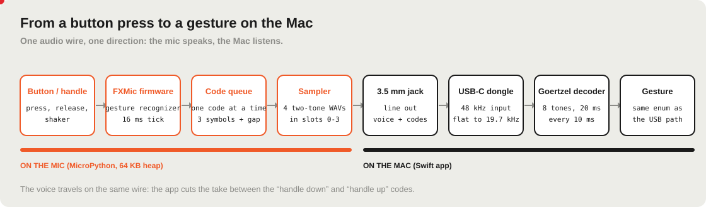
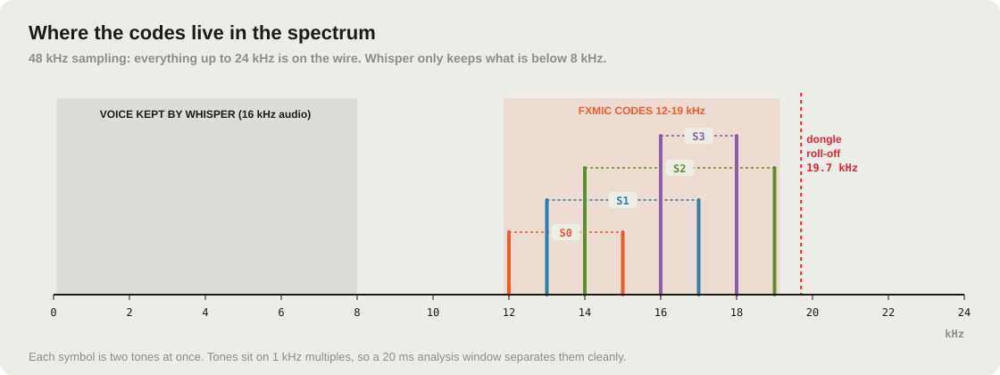
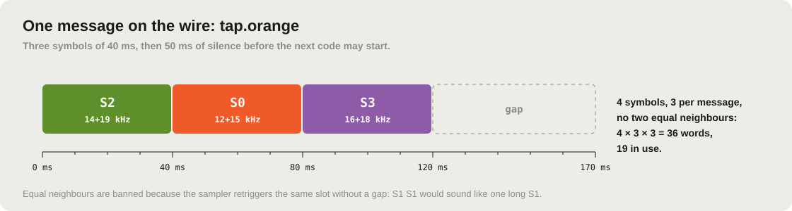
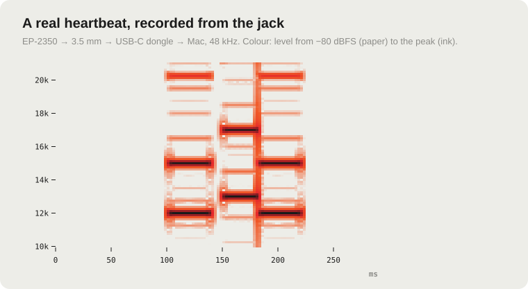
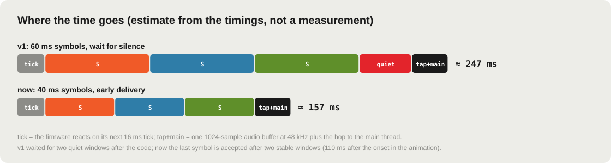

# Talking over a 3.5 mm jack: how the FX MIC sends buttons as sound

> A teaching guide to the jack-only connection between the EP-2350 FX MIC (running the FXMic firmware) and the CUE-2350 MIC app.
> It explains the idea, the numbers and the trade-offs, so the same trick can be reused on other devices.
> Decisions and history live in [ADR-002](adr/adr-002-jack-only-acoustic-control-channel.md), [ADR-003](adr/adr-003-persistent-fxmic-firmware-via-romfs-json-hook.md) and [One-Pager 002](design-docs/onepager-002-jack-only-transport.md).
> Every picture and sound on this page is generated by [`docs/jack/build_assets.py`](jack/build_assets.py) from the real codebook; the spectrogram comes from a real recording.

**Contents:** [1. The problem](#1-the-problem) · [2. The idea in one picture](#2-the-idea-in-one-picture) · [3. Choosing the frequencies](#3-choosing-the-frequencies) · [4. An alphabet of four sounds](#4-an-alphabet-of-four-sounds) · [5. Words of three symbols](#5-words-of-three-symbols) · [6. The mic's side](#6-the-mics-side-recognise-first-then-speak) · [7. The Mac's side](#7-the-macs-side-the-decoder) · [8. Voice and codes on one wire](#8-voice-and-codes-on-one-wire) · [9. Never lose the release](#9-never-lose-the-release) · [10. What it looks like for real](#10-what-it-looks-like-for-real) · [11. Speed](#11-speed) · [12. Limits](#12-limits) · [13. Reusing the idea](#13-reusing-the-idea) · [14. Where the code is](#14-where-the-code-is)

---

## 1. The problem

The FX MIC has two cables.
- **USB-C** carries everything: the app talks to the mic's MicroPython prompt, reads every press and drives the LEDs.
- **The 3.5 mm jack** carries a single thing: **audio, from the mic to the Mac.**

The goal was to use the mic with the jack alone, through a cheap USB-C audio dongle. The jack has to carry both the **voice** and the **commands** (handle, three buttons, shake), and it only goes one way.

The answer: **the mic plays a short sound for every gesture, and the Mac listens for it.** A modem, in the spirit of the touch-tone (DTMF) phone, tuned so it stays out of the way of the voice.

## 2. The idea in one picture

1. On the mic, a custom firmware (FXMic) watches the buttons and recognises **gestures**: tap, double tap, long press, handle down/up, shake.
2. Each gesture becomes a **code**: three short two-tone sounds, played by the mic's own sampler.
3. The sound goes out of the jack, mixed with the voice, into a USB-C dongle.
4. On the Mac the app records **all the time**, runs a small **decoder** on the stream and turns codes back into the same `Gesture` values that the USB path produces. Everything after that (channels, slots, dictation, voice commands) does not know which cable was used.

## 3. Choosing the frequencies

The band has to satisfy three constraints at once:

| Constraint | Number | Consequence |
|---|---|---|
| Speech recognition (Whisper) works on 16 kHz audio | keeps **< 8 kHz** | anything above 8 kHz is thrown away before transcription, so the codes never reach Whisper |
| The dongle samples at 48 kHz | measured **flat to ~19.7 kHz** | codes must stay below ~19.7 kHz |
| Voice and room noise | strongest below ~4 kHz; noise floor **−61 dBFS** measured | a quiet code above 12 kHz is easy to see |

So the codes live in **12–19 kHz**. Two honest notes:
- This is **not inaudible**. Many people, especially young ones, hear 12–19 kHz as a faint high "tick". The codes are short (≈ 120 ms) and quiet; they are discreet, not silent.
- The tones sit on **whole kHz** (12, 13, …, 19). With a 20 ms analysis window, frequencies 1 kHz apart are orthogonal: each tone shows up in its own detector and not in its neighbours.

## 4. An alphabet of four sounds

The mic's sampler holds a handful of short WAV files and can trigger them on demand. FXMic loads **four symbols**, each made of **two tones played together**:

| Symbol | Tones | Listen (600 ms, so you can hear it) |
|---|---|---|
| **S0** | 12 + 15 kHz | <audio controls src="jack/audio/symbol-0.wav"></audio> [symbol-0.wav](jack/audio/symbol-0.wav) |
| **S1** | 13 + 17 kHz | <audio controls src="jack/audio/symbol-1.wav"></audio> [symbol-1.wav](jack/audio/symbol-1.wav) |
| **S2** | 14 + 19 kHz | <audio controls src="jack/audio/symbol-2.wav"></audio> [symbol-2.wav](jack/audio/symbol-2.wav) |
| **S3** | 16 + 18 kHz | <audio controls src="jack/audio/symbol-3.wav"></audio> [symbol-3.wav](jack/audio/symbol-3.wav) |

> The players work in VS Code, Obsidian and most Markdown viewers; on GitHub use the links. Turn the volume **down** first: these are pure high tones.

**Why two tones and not one?** A single high whistle can come from many places: a sibilant "s", a squeaky chair, a TV. Two specific tones *at exactly the same time*, both stronger than any other pair, are very unlikely by accident. The decoder (§7) takes the **weaker** of the two tones as the symbol's score, so half a symbol counts for nothing.

## 5. Words of three symbols

A **message** is three symbols of **40 ms**, followed by **50 ms of silence** before the next code may start.

One rule is not obvious and came from a real test: **two equal symbols cannot be neighbours.** When the sampler retriggers the slot that is already playing, there is no gap, and *S1 S1* sounds exactly like one long *S1*. So the second symbol differs from the first, and the third from the second: 4 × 3 × 3 = **36 possible words**, of which **19 are used**:

| Message | Symbols | Message | Symbols |
|---|---|---|---|
| heartbeat | S0 S1 S0 | longPress.grey | S0 S2 S0 |
| handleDown | S1 S0 S1 | longPress.white | S0 S2 S3 |
| handleUp | S2 S3 S2 | longPress.orange | S0 S3 S0 |
| handleDoubleClick *(reserved)* | S3 S2 S3 | veryLongPress.grey | S0 S3 S1 |
| tap.grey | S0 S2 S1 | veryLongPress.white | S0 S3 S2 |
| tap.white | S1 S2 S0 | veryLongPress.orange | S1 S0 S2 |
| tap.orange | S2 S0 S3 | chordGrey (grey while talking) | S1 S0 S3 |
| doubleTap.grey | S3 S0 S2 | shake | S1 S2 S1 |
| doubleTap.white | S0 S1 S2 | shakeHold | S1 S2 S3 |
| doubleTap.orange | S0 S1 S3 | | |

Listen to a few, at real speed and **8× slower and lower** (every tone divided by 8, so you can hear the "melody"):

| Message | Real speed | 8× slower, 3 octaves lower |
|---|---|---|
| heartbeat | <audio controls src="jack/audio/msg-heartbeat.wav"></audio> [wav](jack/audio/msg-heartbeat.wav) | <audio controls src="jack/audio/msg-heartbeat-slow.wav"></audio> [wav](jack/audio/msg-heartbeat-slow.wav) |
| handleDown | <audio controls src="jack/audio/msg-handleDown.wav"></audio> [wav](jack/audio/msg-handleDown.wav) | <audio controls src="jack/audio/msg-handleDown-slow.wav"></audio> [wav](jack/audio/msg-handleDown-slow.wav) |
| handleUp | <audio controls src="jack/audio/msg-handleUp.wav"></audio> [wav](jack/audio/msg-handleUp.wav) | <audio controls src="jack/audio/msg-handleUp-slow.wav"></audio> [wav](jack/audio/msg-handleUp-slow.wav) |
| tap.orange | <audio controls src="jack/audio/msg-tap-orange.wav"></audio> [wav](jack/audio/msg-tap-orange.wav) | <audio controls src="jack/audio/msg-tap-orange-slow.wav"></audio> [wav](jack/audio/msg-tap-orange-slow.wav) |

**One source of truth.** The codebook ([`firmware/fxmic/codebook.json`](../firmware/fxmic/codebook.json)) is the only place where symbols, timings and messages are written. [`build.py`](../firmware/fxmic/build.py) generates from it the four WAVs for the mic, the firmware's config and the Swift table used by the decoder. The two ends can never disagree.

## 6. The mic's side: recognise first, then speak

The first idea was to send raw events ("orange down", "orange up") and keep all the logic on the Mac. It does not work: every code takes ~130 ms and the mic can play **one code at a time**, so a fast double tap becomes four queued codes, delivered late. The Mac would measure the *queue*, not your finger.

So **gestures are recognised on the mic**, with the same rules and thresholds as the app's own recognizer (tap ≤ 450 ms, double tap within 300 ms, long press 600 ms, very long 3 s, shake thresholds…). Only the *result* is sent: one code per gesture.

How FXMic runs on a small device (MicroPython, 64 KB of RAM):
- It starts at power-on through a hook in the read-only ROM filesystem ([ADR-003](adr/adr-003-persistent-fxmic-firmware-via-romfs-json-hook.md)); holding orange for 1.5 s right after power-on gives the mic back to the factory logic.
- The mic calls it on every button event and on a **16 ms tick**. Everything is allocated up front; nothing grows inside the callbacks.
- Codes go into a 16-entry ring queue. On each tick the player triggers the next symbol when its time has come (40 ms apart), then waits the 50 ms gap.
- A **heartbeat** every 5 s says "I'm here"; the app shows "connected through the jack" while it hears one at least every 12 s.

The mic also does what it can **without hearing back from the Mac**: it pages its own LEDs (red = channel pages created with a long press of orange, white = slot 0–15 in binary) and plays the same red "sweep" as the app while the handle is held. When the app quits with USB-C connected, it hands its state to the firmware so the LEDs match.

## 7. The Mac's side: the decoder

*The animation above runs the real algorithm on the real waveform of `tap.orange`, 32× slower.*

The decoder ([`JackDecoder.swift`](../app/Sources/FXMicCore/JackDecoder.swift)) is under 200 lines and uses no FFT library:

1. **Every 10 ms, look at the last 20 ms.** With a hop of half a window, every 40 ms symbol fully contains at least two windows, wherever it starts.
2. **Measure only the 8 frequencies that matter**, with the [Goertzel algorithm](https://en.wikipedia.org/wiki/Goertzel_algorithm): a tiny recursive filter that gives the strength of *one* frequency, cheaper than a full FFT when you need just a few.
3. **Score each symbol** as the weaker of its two tones. A window **names a symbol** only if that score is above a threshold (amplitude 0.008, ≈ −42 dBFS) **and** at least **2.5×** the second best symbol. Windows that straddle two symbols, or that hold noise, say "nothing".
4. **Two windows in a row** with the same symbol make a **run**.
5. **Three runs** that form a word of the codebook make a **message**, delivered **as soon as the third run is stable**, without waiting for the silence after it.
6. Each message carries its **onset**: the sample where it started, to within 10 ms. This timestamp is the secret ingredient of §8 and §9.

The tests ([`JackDecoderTests.swift`](../app/Tests/FXMicCoreTests/JackDecoderTests.swift)) check every message, back-to-back codes, any chunk size, quiet and noisy channels, a truncated code (rejected), single tones (rejected), and seconds of synthetic voice, music and hiss (no false code).

## 8. Voice and codes on one wire

The same stream is the voice. The app keeps the last 30 s of audio in a ring buffer and, for a dictation:
- the take **starts** at the onset of `handleDown`, minus 50 ms;
- the take **ends** at the onset of `handleUp`;
- it is resampled to 16 kHz for Whisper. The resampler's low-pass filter removes everything above 8 kHz, **including the codes that are inside the take**.

Because the cut uses the *onsets* measured on the audio clock, neither the mic's queue nor the decoding delay changes where the take begins and ends.

## 9. Never lose the release

The worst failure of a push-to-talk is a lost "release": the app keeps recording until something else happens. Three layers prevent it:

| Layer | Where | What it does |
|---|---|---|
| Repeat | mic | `handleUp` is played twice, 250 ms apart (the second is ignored if the handle is already up) |
| Heartbeat as proof | mic + app | the mic never plays a heartbeat while the handle is held. If the app thinks the handle is down and hears a heartbeat, the release was lost: it closes the take there |
| Audio-clock timing | app | handle clicks and double clicks (new line) are measured on the code onsets with the same recognizer as the USB path, so queueing cannot turn a double click into two slow clicks |

## 10. What it looks like for real

A heartbeat (S0 S1 S0) recorded from the mic, through the jack and the dongle (listen: <audio controls src="jack/audio/real-heartbeat.wav"></audio> [real-heartbeat.wav](jack/audio/real-heartbeat.wav)). What to notice:
- The **pairs of tones** at 12+15, 13+17, 12+15 kHz, 40 ms each, are far stronger than everything else.
- **Fainter extra lines** are distortion products of the mic's output; they are weaker than the real tones, so the 2.5× rule ignores them.
- The **vertical streak** is a click: a broadband transient where the sampler switches symbol. It is short and spreads over every frequency, so no symbol wins those windows.
- The small **gap** between symbols is the 16 ms tick jitter: the decoder only needs two clean windows per symbol, so it does not mind.

## 11. Speed

From a press to a gesture on the Mac takes roughly the length of the code. Two changes brought it from ≈ 250 ms to ≈ 160 ms (an estimate from the timings, not a measurement): **shorter symbols** (60 → 40 ms) and **early delivery** (no waiting for the silence after the code). Gestures that must wait by nature, such as a tap that might become a double tap, take the same time as over USB.

## 12. Limits

- **One way only.** The Mac cannot tell the mic anything over the jack: the LEDs cannot show "processing" or a confirmation, and the mic's LED pages can drift from the app (it does not know which channels you bound in Settings).
- **Slower than USB** (≈ 150 ms per gesture instead of a few milliseconds), and one code at a time.
- **Error tolerance is thin.** Valid words can differ by a single symbol; robustness comes from the two-tone rule and the 2.5× separation, not from error correction. A parity symbol would buy distance 2 at the cost of 40 ms.
- **Audible to some people**, and the level depends on the mic's output volume (the threshold is ≈ −42 dBFS per tone).
- **Needs the custom firmware**, installed over USB-C ([`tools/fxmic_install.py`](../tools/fxmic_install.py), with a full backup and read-back check).

## 13. Reusing the idea

This works for any device that can **play a sound** and is connected to a computer that can **listen**: synths, pedals, toys, a phone's headphone jack, an old device with a line out.

1. **Put the data where the payload isn't.** Find the band your real signal does not need (here: above Whisper's 8 kHz) and below what the cable or converter can carry.
2. **Make symbols unmistakable.** Two simultaneous tones on an orthogonal grid, scored by the weaker tone, with a clear margin over the runner-up.
3. **Respect the physics of your player.** If repeating a sound merges it, ban equal neighbours.
4. **Decide at the source.** If the channel is slow, send *meanings* (gestures), not raw events.
5. **Timestamp on the receiver's clock.** Onsets in samples make timing immune to queues and delays.
6. **Say "I'm alive".** A heartbeat gives presence detection and, with a rule about when it is allowed, a way to recover lost messages.
7. **One codebook, generated everywhere.** Sender assets and receiver tables from a single file.
8. **Test with the enemy.** Voice, music, hiss and broken codes must produce nothing.

Related techniques: DTMF, FSK modems, and data-over-sound libraries such as ggwave; this design is a small, specialised cousin tuned for latency and for sharing the wire with a voice.

## 14. Where the code is

| What | File |
|---|---|
| Codebook (symbols, timings, messages) | [`firmware/fxmic/codebook.json`](../firmware/fxmic/codebook.json) |
| Generator (WAVs, firmware config, Swift table) | [`firmware/fxmic/build.py`](../firmware/fxmic/build.py) |
| Firmware: recognizer, code player, LEDs | [`firmware/fxmic/device/fxmic.py`](../firmware/fxmic/device/fxmic.py) |
| Boot hook | [`firmware/fxmic/device/json.py`](../firmware/fxmic/device/json.py) |
| Installer (backup, write, verify, restore) | [`tools/fxmic_install.py`](../tools/fxmic_install.py) |
| Decoder | [`app/Sources/FXMicCore/JackDecoder.swift`](../app/Sources/FXMicCore/JackDecoder.swift) |
| Jack transport (signal, takes, handle timing) | [`app/Sources/FXMicBridge/JackTransport.swift`](../app/Sources/FXMicBridge/JackTransport.swift) |
| Continuous recording and resampling | [`app/Sources/FXMicBridge/AudioRecorder.swift`](../app/Sources/FXMicBridge/AudioRecorder.swift) |
| Decoder tests | [`app/Tests/FXMicCoreTests/JackDecoderTests.swift`](../app/Tests/FXMicCoreTests/JackDecoderTests.swift) |
| Pictures and sounds of this page | [`docs/jack/build_assets.py`](jack/build_assets.py) |
