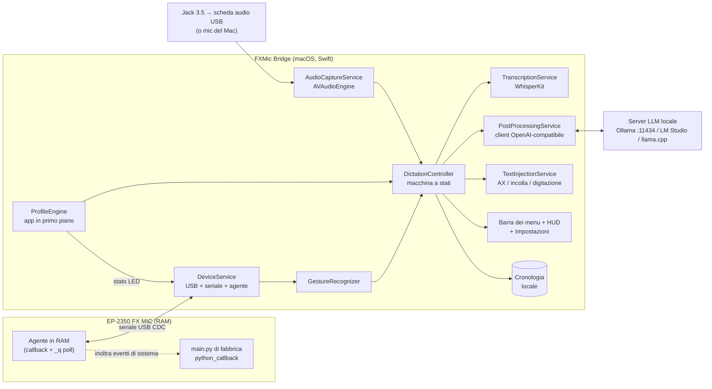

# TDD — FXMic Bridge: app macOS per dettatura locale con EP-2350 FX MIC

> Versione: v1
> Data: 2026-10-15
> Autore: g.caletti@reply.it (con Claude)
> Stato: Approvato. Aggiornato il 2026-10-15 con gli esiti degli spike M0, vedi `logs/TEST_NOTES.md`.

## 1. Contesto e obiettivi

**Introduzione**
FXMic Bridge è un'app macOS che vive nella barra dei menu e trasforma l'EP-2350 FX MIC in un controller di dettatura. Tieni premuta la maniglia, parli, e il testo trascritto in locale con Whisper viene scritto dove si trova il cursore. Prima di essere scritto, il testo può passare da un LLM locale con un prompt scelto tramite i pulsanti del mic.

Il progetto parte dai test esplorativi in `logs/TEST_NOTES.md`. Quei test hanno mostrato che la console MicroPython del mic via USB permette di leggere pulsanti, maniglia e accelerometro in tempo reale, e di pilotare i LED, senza scrivere niente sul flash o sul disco del dispositivo.

**Obiettivi**
- **Push-to-talk:** la maniglia avvia e ferma la registrazione, con una scorciatoia da tastiera come ripiego quando il mic non è collegato.
- **Trascrizione locale** con WhisperKit. Obiettivo: testo scritto entro **1,5 s** dal rilascio della maniglia per una frase di 10 s in modalità Raw (valore da misurare in M1).
- **Post-elaborazione opzionale** tramite un endpoint LLM locale compatibile OpenAI. Obiettivo: entro **3 s** con un modello di 3–4 miliardi di parametri.
- **Testo scritto nell'app in primo piano**, nel punto del cursore. Deve funzionare in Terminale/iTerm (Claude Code, Codex), browser, Slack, Mail, Notes e VS Code.
- **Pulsanti mappati su prompt** tramite **profili per app**:
  - l'arancione sceglie la Modalità;
  - il bianco sceglie lo Stile;
  - il grigio esegue azioni.
  
  La mappatura cambia automaticamente in base all'app in primo piano, e i LED del mic mostrano lo stato del profilo attivo.
- **Dispositivo sempre ripristinabile:** l'app non scrive mai su flash, ROM o FX MIC DISK. Ogni modifica vive nella RAM del mic e sparisce chiudendo l'app o spegnendo il mic.

**Fuori obiettivo (v1)**
- Audio tramite cavo USB-C (streaming via seriale): sarà uno spike in M4.
- Firmware personalizzato, modifiche a `config.json` o ai campioni del mic.
- Trascrizione in streaming con testo parziale scritto mentre si parla. In v1 il testo si scrive tutto al rilascio, e l'interfaccia mostra solo l'indicatore di livello.
- Supporto a Windows o Linux, e distribuzione su Mac App Store.
- Servizi cloud di trascrizione o LLM. L'endpoint è configurabile, ma il valore predefinito e quello supportato è localhost.

## 2. Architettura generale

**Diagramma dei componenti**



**Flusso principale (dettatura con post-elaborazione)**
1. **Ascolto:** l'utente tiene il cursore in un campo di testo. L'agente sul mic invia `E 2 4` (maniglia premuta), e `GestureRecognizer` lo trasforma in `pttDown`.
2. **Registrazione:** `DictationController` passa a `Recording`. `AudioCaptureService` registra dall'ingresso scelto, convertito in mono a 16 kHz. L'HUD mostra lo stato, la Modalità e lo Stile attivi e l'indicatore di livello.
3. **Rilascio:** al rilascio della maniglia (`E 1 4`) arriva `pttUp`.
   - Se la registrazione dura meno di 300 ms, o contiene solo silenzio, viene scartata.
   - Altrimenti l'audio passa a `TranscriptionService`, che restituisce il testo grezzo.
4. **Post-elaborazione:** se la Modalità del profilo attivo non è Raw, `PostProcessingService` compone il prompt (base + Modalità + Stile + contesto) e chiama `/v1/chat/completions`.
5. **Scrittura:** `TextInjectionService` scrive il risultato nell'app in primo piano con la strategia indicata dal profilo. La cronologia salva il testo grezzo e quello elaborato.
6. **Errori:** se l'LLM fallisce o va in timeout, viene scritto il testo grezzo e l'HUD segnala "LLM non disponibile".

## 3. Progettazione dettagliata

### 3.1 Protocollo con il dispositivo (DeviceService)

**Rilevamento**
- Notifiche IOKit di collegamento e scollegamento USB, filtrate su VID `0x2367` e PID `0x0620`.
- La porta seriale è `/dev/cu.usbmodemEP*`. Il protocollo è CDC, quindi la velocità impostata viene ignorata.
- Per aprire la porta si usa POSIX/termios direttamente, senza dipendenze esterne.

**Handshake**
1. All'apertura il mic stampa `MICROPYTHON <v>; EP-2350 <fw>` seguito dal prompt `>>> `.
2. L'app confronta `<fw>` con una lista di versioni compatibili, inizialmente solo `1.0.9`.
   - Versione nella lista: si procede.
   - Versione fuori lista: modalità "solo lettura" con avviso. Si leggono gli eventi senza nascondere le azioni di fabbrica.
3. L'app verifica che esistano `python_callback`, `ui`, `fx` e `spl`.

**Installazione dell'agente**
L'agente si carica in RAM con la paste mode di MicroPython (Ctrl-E … Ctrl-D), con la stessa tecnica di `tools/event_tap.py`, già verificata:

```python
_pt = False            # passthrough: True = il mic si comporta come di fabbrica
def _tap(m):
    t = m >> 16; v = m & 0xFFFF
    if t in (1, 2):
        print('\nE', t, v)               # '\n' iniziale: l'evento può arrivare mentre il REPL mostra '>>> '
        if not _pt and v in (0, 1, 2):   # nasconde i pulsanti, il mic resta "clean"
            return
    elif t == 4:
        print('\nE', t, v)               # disco espulso: lascia ricaricare la config
    python_callback(m)                   # maniglia, tick, ADC, eject → logica di fabbrica
def _q(): print('Q', round(ui.handle(), 3), round(ui.shaker(), 3), ui.acc())
ui.callback(_tap); fx.load_preset(-1); print('AGENT_OK')
```

**Formato delle righe in uscita** (una per riga, separate da `\r\n`)

| Riga | Significato |
|---|---|
| `E <type> <value>` | Evento. type 1/2 = attivo/inattivo; value 0 = grigio, 1 = bianco, 2 = arancione, 4 = maniglia (polarità invertita: 2 = premuta). type 4 = disco espulso. |
| `Q <handle 0..1> <shaker> [ax, ay, az]` | Risposta al polling, a 10 Hz (verificato fino a 19 Hz). |
| `AGENT_OK` / `AGENT_OFF` | Agente installato o rimosso. |

**Lettura tollerante (esito M0-c).** L'output del callback può finire sulla stessa riga del prompt, per esempio `>>> E 1 1`. Il parser deve quindi cercare `E <t> <v>` e `Q …` in qualsiasi punto della riga, e non solo all'inizio. Con questa correzione sono stati catturati 40 eventi su 40.

**Comandi dall'app**
Sono righe di testo inviate al REPL e serializzate in una coda, una alla volta:
- `_q()` per il polling;
- `ui.leds(<rosso>,<bianco>)` per i LED. **Verificato in M0-b**: disegna due barre, e il valore *n* accende *n+1* LED. Con -1 i rossi sono tutti spenti; i bianchi mostrano sempre almeno un LED. Il rosso indica la Modalità (spenti = Raw), il bianco lo Stile;
- `ui.led_control(0)` passa al controllo manuale, dove `ui.led_level(i, livello)` funziona con i da 0 a 7 e `leds()` viene ignorato. `ui.led_control(1)` torna al controllo di fabbrica. Serve per animazioni come il lampeggio in registrazione. Restano da definire quale indice corrisponde a quale LED e la scala di luminosità: a occhio, tutti i valori maggiori di 0 sembrano accendere il LED al massimo;
- `_pt=True` / `_pt=False` per la modalità passthrough.

**Ripristino**
Avviene alla chiusura dell'app, quando l'utente sceglie "Rilascia dispositivo" o quando cambia lo stato del disco:

```python
ui.callback(python_callback); ui.led_control(1); ui.leds(fx_pos, sam_pos); fx.load_preset(fx_pos); print('AGENT_OFF')
```

**Riconnessione (verificata in M0-c).** Se il cavo viene scollegato o il mic spento, la lettura fallisce con `Errno 6 Device not configured`. La porta ricompare dopo 10–20 s dalla riaccensione, e l'agente si reinstalla in circa 150 ms. Il polling su `/dev/cu.usbmodemEP*` ogni 0,5 s basta per M1; le notifiche IOKit restano un miglioramento.

Se l'app si chiude in modo anomalo, l'agente resta attivo finché il mic non viene spento. Al riavvio l'app rileva `_tap` in `globals()` e lo reinstalla in modo idempotente. Il menu offre anche "Ripristina dispositivo", che usa la stessa logica di `tools/restore.py`.

**Mai usati:** `test.bootloader`, `ui.shutdown`, `rp2.Flash`, `vfs.*`, scrittura in `/fat`.

### 3.2 Riconoscimento dei gesti (GestureRecognizer)

Trasforma gli eventi grezzi in gesti con soglie configurabili.

| Ingresso | Gesto | Regola predefinita |
|---|---|---|
| Maniglia | `pttDown` / `pttUp` | Eventi `E 2 4` / `E 1 4`. In alternativa la posizione analogica con isteresi: premuta oltre 0,15, rilasciata sotto 0,06. |
| Ogni pulsante | `tap` | Pressione più breve di 450 ms, senza un secondo tap entro 300 ms. |
| Ogni pulsante | `doubleTap` | Due tap entro 300 ms. |
| Ogni pulsante | `longPress` | Pressione di almeno 600 ms. Scatta durante la pressione, senza aspettare il rilascio. |
| Grigio durante il PTT | `chord(grey)` | Grigio premuto mentre la maniglia è premuta: la registrazione corrente diventa una "modifica della selezione". |
| Scuotimento | `shake` | `shaker` sopra 0,5 per almeno 2 letture consecutive. Dai test: a riposo circa 0, scuotimento leggero 0,25–0,38, forte 0,6–0,9. |
| Maniglia | `handleDoubleClick` | Due pressioni più brevi di 280 ms, con la seconda che inizia entro 400 ms dal primo rilascio. Le due pressioni sono anche registrazioni troppo brevi, quindi vengono scartate senza avvisi. *(Aggiunto il 2026-10-15)* |
| Scuotimento | `shakeHold` | Scuotimento forte (`shaker` sopra 0,5) mantenuto per almeno 2 s. Cali sotto la soglia più brevi di 400 ms non interrompono il conteggio. *(Aggiunto il 2026-10-15)* |

L'elenco aggiornato di tutti i gesti, delle azioni e del collegamento che richiedono (USB-C, jack o tastiera) è in [`docs/GESTURES.md`](../GESTURES.md).

**Scorciatoie predefinite** (in M1 valgono per tutte le app; con i profili di M2 diventano configurabili per app):

| Gesto | Azione | Tasti inviati |
|---|---|---|
| Doppio clic sulla maniglia | Nuova riga | ⇧↩ |
| Tocco sul grigio | Invio | ↩ |
| Scuotimento forte per 2 s | Cancella tutto | ⌘A, poi ⌫ |
| Scuotimento breve | Annulla la dettatura in corso | — |

Ogni dettatura scritta termina con uno spazio, se non finisce già con uno spazio o un a-capo, così la frase successiva non si attacca alla precedente.

**Limiti noti:**
- "Cancella tutto" con ⌘A agisce su tutto il campo o documento attivo. In un editor di testo cancella l'intero documento, recuperabile con ⌘Z. Nei terminali ⌘A seleziona lo scrollback e non il prompt, quindi il prompt non viene cancellato. Per Claude Code nel terminale serve un'azione specifica per app in M2, per esempio Ctrl+U.
- ⇧↩ va a capo in Claude Code solo nei terminali configurati per farlo (iTerm2, Ghostty, VS Code dopo `/terminal-setup`). Terminal.app usa ⌥↩.

Con la maniglia premuta, arancione e bianco non cambiano Modalità o Stile, come fa il firmware di fabbrica. Così si evitano cambi accidentali mentre si parla.

### 3.3 Profili per app (ProfileEngine)

- **Scelta del profilo:** `NSWorkspace.didActivateApplicationNotification` restituisce il bundle ID dell'app in primo piano.
  - Il profilo è il primo che contiene quel bundle ID in `apps`.
  - Se nessuno corrisponde, si usa `default`.
- **Stato per profilo:** ogni profilo ricorda la sua Modalità e il suo Stile. Al cambio di app i LED si aggiornano subito, e l'HUD mostra per 1,2 s un avviso con il nome del profilo, della Modalità e dello Stile.
- **Arancione:** scorre tra `Raw` (LED arancioni spenti, -1) e fino a 4 Modalità (LED da 0 a 3).
- **Bianco:** scorre tra fino a 4 Stili (LED bianchi da 0 a 3). Lo Stile 0 è "Neutro", con prompt vuoto. In Modalità Raw gli Stili vengono ignorati.
- **Grigio:** ha azioni configurabili per `tap`, `doubleTap`, `longPress` e `chord`.

**Modello dati.** Il file è `~/Library/Application Support/FXMicBridge/config.json` e ha uno schema versionato.

```json
{
  "schemaVersion": 1,
  "audio": { "inputDeviceUID": "AppleUSBAudioEngine:...", "preRollMs": 300, "minDurationMs": 300 },
  "speech": { "model": "openai_whisper-large-v3-turbo", "language": "auto", "vocabulary": ["Claude", "MCP", "repo"] },
  "llm": { "baseURL": "http://localhost:11434/v1", "model": "qwen3:4b", "timeoutMs": 8000, "temperature": 0.2,
           "baseSystemPrompt": "Sei un post-processore di dettatura. Restituisci solo il testo finale, senza commenti." },
  "injection": { "defaultStrategy": "paste", "restoreClipboardMs": 250 },
  "history": { "enabled": true, "retentionDays": 7, "saveAudio": false },
  "gestures": { "longPressMs": 600, "doubleTapMs": 300, "shakeThreshold": 0.5 },
  "profiles": [
    {
      "id": "default", "name": "Generale", "apps": [],
      "modes": [
        { "name": "Pulito", "prompt": "Correggi punteggiatura ed errori di trascrizione, mantieni le parole." },
        { "name": "Email", "prompt": "Riscrivi come email chiara e cortese." },
        { "name": "Traduci EN", "prompt": "Traduci in inglese naturale." },
        { "name": "Elenco", "prompt": "Trasforma in elenco puntato sintetico." }
      ],
      "styles": [
        { "name": "Neutro", "prompt": "" },
        { "name": "Conciso", "prompt": "Sii il più breve possibile." },
        { "name": "Formale", "prompt": "Registro formale." },
        { "name": "Amichevole", "prompt": "Tono informale e amichevole." }
      ],
      "grey": { "tap": { "type": "key", "keys": "return" },
                "doubleTap": { "type": "undoLastInsertion" },
                "longPress": { "type": "reinsertLast", "variant": "raw" },
                "chord": { "type": "editSelection" } },
      "shake": { "type": "cancel" },
      "injection": null
    },
    {
      "id": "coding-agent", "name": "Agente di coding",
      "apps": ["com.apple.Terminal", "com.googlecode.iterm2", "com.mitchellh.ghostty", "com.microsoft.VSCode"],
      "modes": [
        { "name": "Istruzione", "prompt": "Riscrivi come istruzione chiara e completa per un agente di coding. Mantieni nomi di file, simboli e comandi esatti." },
        { "name": "Bug report", "prompt": "Struttura come: comportamento atteso, comportamento osservato, passi per riprodurre." },
        { "name": "Commit msg", "prompt": "Scrivi un messaggio di commit convenzionale." },
        { "name": "Domanda", "prompt": "Formula una domanda precisa sul codice." }
      ],
      "styles": [ { "name": "Neutro", "prompt": "" }, { "name": "Conciso", "prompt": "Massimo 2 frasi." },
                  { "name": "Dettagliato", "prompt": "Includi criteri di accettazione." }, { "name": "Inglese", "prompt": "Scrivi in inglese." } ],
      "grey": { "tap": { "type": "key", "keys": "return" },
                "doubleTap": { "type": "text", "text": "/clear\n" },
                "longPress": { "type": "key", "keys": "escape" },
                "chord": { "type": "editSelection" } },
      "shake": { "type": "cancel" },
      "injection": "paste"
    }
  ]
}
```

**Tipi di azione:**

| Tipo | Cosa fa |
|---|---|
| `key` | Combinazione di tasti, per esempio `return`, `cmd+z`, `escape`. |
| `text` | Testo letterale, con `\n` = Invio. Serve per esempio a lanciare `/skill`. |
| `prompt` | Applica un prompt al testo selezionato, senza dettatura. |
| `editSelection` | Applica l'istruzione dettata al testo selezionato. |
| `undoLastInsertion` | Annulla l'ultimo inserimento. |
| `reinsertLast` | Riscrive l'ultimo testo, in versione `raw` o `processed`. |
| `cancel` | Annulla la dettatura in corso. |
| `cycleProfile` | Passa al profilo successivo. |
| `none` | Nessuna azione. |

### 3.4 Composizione del prompt (PostProcessingService)

```
system = llm.baseSystemPrompt
       + "\n\n## Modalità: " + mode.prompt
       + (style.prompt ? "\n## Stile: " + style.prompt : "")
       + "\n## Contesto: app={{app_name}}, lingua={{language}}, data={{date}}"
user   = "{{transcript}}"                                  // dettatura normale
user   = "Testo:\n{{selection}}\n\nIstruzione:\n{{transcript}}"   // editSelection
```

- **Chiamata:** `POST {baseURL}/chat/completions` con `stream: false` e `temperature` presa dalla config.
- **Pulizia della risposta:** l'app toglie gli spazi in eccesso e i blocchi `<think>…</think>`, per i modelli che "ragionano".
- **Timeout o errore:** viene usato il testo grezzo e l'errore resta in cronologia.
- **Avvio a freddo:** dopo la prima chiamata Ollama tiene il modello in memoria per 5 minuti (`keep_alive`). L'app può mandare una richiesta di "riscaldamento" quando passi a una Modalità diversa da Raw.

### 3.5 Macchina a stati della dettatura (DictationController)

```
Idle --pttDown--> Recording
Recording --pttUp (≥ minDuration)--> Transcribing
Recording --pttUp (< minDuration) | shake--> Idle (scartata)
Transcribing --testo--> PostProcessing (modalità ≠ Raw) | Injecting (Raw)
Transcribing --vuoto/silenzio--> Idle (HUD: "Nessun parlato")
PostProcessing --ok | errore/timeout (usa raw)--> Injecting
Transcribing | PostProcessing --shake--> Idle (annullata)
Injecting --> Idle (salva in cronologia, memorizza l'inserimento per undo)
```

- Si elabora **una dettatura alla volta**. Un `pttDown` mentre ne è in corso un'altra viene ignorato con un breve suono di errore e un lampeggio nell'HUD.
- **Modalità e Stile si fissano all'inizio della registrazione:** sono quelli attivi al `pttDown`.
- **`editSelection`:** al `pttDown` con il grigio premuto, l'app legge la selezione corrente via AX (`kAXSelectedTextAttribute`). Se AX non funziona, salva gli appunti, simula `cmd+c`, legge il testo e ripristina gli appunti. Se non c'è selezione, la dettatura procede come normale.

### 3.6 Audio (AudioCaptureService)

- **Registrazione:** `AVAudioEngine` con un tap sull'ingresso scelto tramite CoreAudio UID, convertito in mono Float32 a 16 kHz, cioè il formato richiesto da Whisper.
- **Pre-roll:** un buffer circolare conserva gli ultimi 300 ms prima del `pttDown`, utile soprattutto con il mic del Mac. Con FX-MIC il microfono si attiva solo a maniglia premuta, quindi il pre-roll contiene silenzio.
- **Ingressi supportati:**
  1. FX-MIC via jack collegato a una scheda audio USB con ingresso linea. Il livello d'uscita arriva a 2 Vrms, quindi si regola con la manopola del volume sotto il coperchio.
  2. Qualsiasi microfono di sistema, come ripiego: in questo caso FX-MIC fa solo da controller.
- **Pre-roll rimandato (decisione del 2026-10-15, dopo il test M1).** In M1 il motore audio parte al `pttDown`, quindi non c'è pre-roll. La registrazione inizia dopo circa 130–150 ms, e la primissima dopo l'avvio dopo 1,75 s. Si accetta così finché la sorgente resta il mic del Mac: con FX-MIC via jack il microfono si attiva solo a maniglia premuta, e il pre-roll non servirebbe. Va rivalutato in M0-a, con la scheda audio.
- **Rilevamento del silenzio:** se il livello RMS medio resta sotto -50 dBFS, la registrazione non va a Whisper. Serve a evitare le frasi inventate da Whisper sul silenzio.

### 3.7 Trascrizione (TranscriptionService)

- **Motore:** WhisperKit (Core ML, Apple Silicon), tramite pacchetto SwiftPM.
- **Modelli:**
  - predefinito `large-v3-turbo`;
  - alternativa leggera `small`.
  
  Si scaricano dal primo avvio guidato, e il download si può gestire dalle Impostazioni.
- **Lingua:** `auto`, oppure fissata per profilo.
- **Vocabolario:** `speech.vocabulary`, insieme al vocabolario del profilo, diventa il prompt iniziale di Whisper, per riconoscere meglio i termini tecnici.

### 3.8 Scrittura del testo (TextInjectionService)

Le strategie si possono scegliere per profilo:

| Strategia | Come funziona | Pro | Contro |
|---|---|---|---|
| `paste` (predefinita) | Salva gli appunti, li riempie con il testo (tipo `org.nspasteboard.TransientType`), simula ⌘V, poi ripristina gli appunti dopo 250 ms. | Funziona quasi ovunque, compresi i terminali, ed è veloce. | Alcune app bloccano l'incolla, e c'è un breve rischio di conflitto con gli appunti. |
| `ax` | `AXUIElementSetAttributeValue(focused, kAXSelectedText, text)` | Non tocca gli appunti. | Non funziona nei terminali né nella maggior parte delle app Electron. |
| `type` | `CGEvent` con `keyboardSetUnicodeString`, a blocchi di 20 caratteri. | Funziona dove l'incolla è bloccato. | Lenta per testi lunghi e può interferire con l'autocompletamento. |

**Regole comuni a tutte le strategie:**
- **Campi sicuri:** se `IsSecureEventInputEnabled()` è attivo, per esempio in un campo password, l'app non scrive niente e lo segnala nell'HUD.
- **Undo:** viene memorizzato l'ultimo inserimento, cioè app, lunghezza e momento. `undoLastInsertion` invia `cmd+z` solo se l'app in primo piano è la stessa e sono passati meno di 30 s.

### 3.9 Interfaccia utente

**Icona nella barra dei menu**
- **Stati:** pronto, in registrazione (rosso), in trascrizione/elaborazione (animata), mic scollegato (grigia barrata), errore.
- **Menu:**
  - profilo, Modalità e Stile correnti, modificabili anche dal menu;
  - ultimi 5 testi, cliccabili per copiarli;
  - "Rilascia/Ripristina dispositivo", Impostazioni, Esci.

**HUD**
- È una pillola semitrasparente in basso al centro dello schermo.
- **Durante la registrazione** mostra:
  - lo stato;
  - le etichette Profilo, Modalità e Stile, per esempio `Agente di coding · Istruzione · Conciso`;
  - un indicatore di livello;
  - un timer.
- **Durante l'elaborazione** mostra un'animazione.
- **Sui cambi di Modalità o Stile** compare per 1,2 s, perché i LED indicano solo un indice e servono i nomi.

**Aggiornamento del 2026-10-16 (app 0.2.x).**
- **L'HUD diventa un'"isola" nera in alto sullo schermo attivo**, cioè quello sotto il puntatore:
  - sugli schermi con notch esce dal notch, con un simbolo di stato a sinistra e il timer a destra del notch, e titolo, dettaglio e livello sotto;
  - senza notch è una pillola nera centrata subito sotto la barra dei menu.
- **L'icona nella barra dei menu si sceglie da un sottomenu** e si salva in `config.json`:
  - si può impostare su `ui.menuBarIcon`, che vale `auto`, `logo`, uno dei preset SF Symbols (`mic`, `micCircle`, `waveform`, `dot`, `sparkles`) oppure `file`;
  - con `file` si indica `ui.menuBarIconFile`, un SVG, PDF o PNG che viene copiato in `icons/` e disegnato monocromatico;
  - durante registrazione, elaborazione ed errori restano i simboli di stato.

**Impostazioni** (una finestra SwiftUI con schede)
1. **Dispositivo:** stato, firmware, test dei LED, soglie della maniglia e dello scuotimento con indicatori in tempo reale, interruttore passthrough.
2. **Audio:** scelta dell'ingresso, indicatore di livello, test di registrazione.
3. **Trascrizione:** modello e download, lingua, vocabolario.
4. **LLM:** URL dell'endpoint, modello (con l'elenco da `/v1/models`), pulsante "Prova prompt", timeout.
5. **Profili:** editor visuale. Si scelgono le app dall'elenco di quelle installate, si scrivono Modalità e Stili con un'anteprima che applica il prompt a una frase di esempio, si mappano le azioni del grigio e si importano o esportano i profili in JSON.
6. **Cronologia:** testi grezzi ed elaborati, con copia, riscrittura e cancellazione. Conservazione configurabile, anche disattivata.

**Primo avvio guidato:** richiede i permessi di Microfono e Accessibilità, propone il download del modello Whisper, verifica il mic e prova l'endpoint LLM.

**Suoni:** click brevi a inizio e fine registrazione, disattivabili.

## 4. Requisiti non funzionali e infrastruttura

**Prestazioni**
- **Latenza da rilascio a testo scritto, modalità Raw:** obiettivo sotto 1,5 s con 10 s di parlato su M5 con 16 GB.
- **Latenza con LLM:** obiettivo sotto 3 s con un modello da 3–4 miliardi di parametri già in memoria.
- **Latenza degli eventi dal mic:** sotto 50 ms (osservata circa 4 ms tra un evento e l'altro).
- **Memoria:**
  - circa 1,5 GB con il modello turbo caricato;
  - circa 0,5 GB con `small`.
  
  Il modello si scarica dalla memoria dopo 10 minuti di inattività (configurabile).
- **CPU a riposo:** sotto l'1%. Il polling seriale a 10 Hz è leggero, e quando il mic è scollegato si smette di interrogarlo.

**Sicurezza e privacy**
- **Elaborazione locale:** tutto avviene sul Mac. La rete si usa solo per l'endpoint LLM configurato. Se l'host non è `localhost`, `127.0.0.1` o `::1`, l'app mostra un avviso esplicito.
- **Dati salvati:** l'audio non viene mai salvato su disco, salvo l'opzione `saveAudio` (disattivata in modo predefinito). La cronologia è in un file JSONL locale con permessi `0600` e conservazione predefinita di 7 giorni.
- **Permessi richiesti:** Microfono e Accessibilità (per incollare, digitare e leggere la selezione).
- **Firma e distribuzione:** l'app è fuori dalla sandbox, perché servono AX e l'accesso diretto alla seriale. Si firma con Developer ID e notarizzazione, oppure con firma ad-hoc per uso personale.
- **Dispositivo:** l'app non scrive mai sul flash del mic ed esegue solo comandi REPL presenti in una lista consentita, scritti nel codice.

**Osservabilità**
- **Log:** `os.Logger` con subsystem `com.fxmicbridge` e categorie `device`, `audio`, `stt`, `llm`, `inject`. Il contenuto dei testi non compare nei log, salvo la modalità debug.
- **Metriche locali** nella scheda Diagnostica: latenza per fase (registrazione, trascrizione, LLM, scrittura), errori dell'LLM, riconnessioni del mic.
- **Supporto:** il pulsante "Esporta diagnostica" crea uno zip con log, configurazione senza prompt e versione del firmware.

## 5. Alternative considerate

- **Python con rumps, pyserial e mlx-whisper.** Scartata come prodotto, perché distribuzione, permessi TCC e avvio al login sono fragili. Resta utile per gli spike, come gli script già presenti in `tools/`.
- **Tauri (Rust con interfaccia web).** Scartata perché le API macOS necessarie (AX, CGEvent, pasteboard, CoreAudio, IOKit) richiederebbero comunque codice nativo, e l'unico vantaggio sarebbe un'interfaccia multipiattaforma, che non è un obiettivo.
- **whisper.cpp invece di WhisperKit.** Resta un ripiego valido dietro l'interfaccia `TranscriptionEngine`. WhisperKit è preferito per l'integrazione Swift e l'accelerazione con l'ANE.
- **LLM integrato con MLX Swift.** Rimandato a dopo la v1: un endpoint compatibile OpenAI permette di cambiare runtime e modello senza ricompilare l'app.
- **Riconoscere i pulsanti dall'audio (campioni con codici, solo jack).** Scartato per la v1: la seriale USB dà eventi più precisi, bidirezionali (LED) e senza consumare gli slot dei campioni. Lo schema resta documentato nell'analisi iniziale. Ripreso come trasporto alternativo "solo jack" in [One-Pager 002](onepager-002-jack-only-transport.md) e [ADR-002](../adr/adr-002-jack-only-acoustic-control-channel.md) (proposta rev. 2: firmware FXMic in `/rom/json.py`, [ADR-003](../adr/adr-003-persistent-fxmic-firmware-via-romfs-json-hook.md), test T1–T9).
- **Usare `config.json` o i campioni del mic per i gesti.** Scartato: richiede di scrivere sul disco del mic, mentre il vincolo è di non lasciare modifiche permanenti.

## 6. Rischi e punti aperti

**Tecnologia**
- **Ingresso jack non verificato.** Livello, rumore e gate della maniglia sull'uscita analogica sono ancora da provare con una scheda audio. Spike M0-a.
- ~~Comportamento di `ui.leds(fx, sam)`~~ **Risolto in M0-b** (barre). Restano aperte la mappa degli indici di `led_level` e la scala di luminosità.
- **`fx.load_preset`** funziona da -1 a 3 e il ripristino con `fx_pos` è verificato, controllando la catena caricata con `fx.timing()`. Non è stato ancora provato a maniglia premuta: l'agente lo chiama solo all'installazione.
- **Manopola del volume** non visibile via software. Il canale ADC 3 è un candidato non confermato.
- **Toolchain:** il Mac ha solo i Command Line Tools. Con SwiftPM si può compilare un eseguibile e assemblare il bundle `.app` con uno script, ma per firmare e notarizzare comodamente conviene Xcode completo. TBD, da confermare con l'utente.

**Dipendenze**
- WhisperKit (argmaxinc, MIT).
- Server LLM locale, come Ollama, già installato.
- Nessuna dipendenza dal codice di fx-usb, che non ha licenza.

**Punti di guasto**
- **Firmware diverso da 1.0.9:** i nomi `python_callback` o `fx_pos` potrebbero cambiare. Si passa alla modalità solo lettura con avviso.
- **Porta seriale occupata** da un altro programma (fx-usb, `screen`, gli script di `tools/`). L'app mostra lo stato "Occupato" con l'elenco dei processi ottenuto da `lsof`.
- **Mic a batteria:** va in risparmio energetico dopo 5 minuti e si spegne dopo 20. L'app rileva lo scollegamento e si riconnette quando ricompare. Con l'alimentazione USB il mic resta acceso.
- **Server LLM non avviato:** si scrive il testo grezzo e l'HUD suggerisce di avviare `ollama serve`.
- **Frasi inventate da Whisper sul silenzio:** si mitigano con il rilevamento del silenzio, la durata minima e la soppressione dei token "no speech".

## 7. Strategia di migrazione

Il progetto parte da zero, quindi non c'è un sistema da migrare. Il piano di rilascio è a milestone:
- **M0 — Spike (esiti del 2026-10-15):**
  - a) jack con scheda audio: **non eseguito**, la scheda audio non è ancora disponibile;
  - b) API dei LED e di `load_preset`: **completato**, con due punti aperti (mappa degli indici e luminosità);
  - c) stabilità dell'agente: **completato**. Più di 15 minuti senza letture perse, riconnessione dopo scollegamento e spegnimento, 40 eventi su 40 dopo la correzione del parser. Il test di 2 ore è rimandato all'uso reale in M1.
- **M1:** DeviceService, GestureRecognizer, dettatura Raw con WhisperKit, scrittura con `paste`, icona nella barra dei menu. **Sorgente audio in M1: il microfono predefinito del Mac**, perché manca la scheda audio. FX-MIC fa solo da controller (maniglia = push-to-talk). `AudioCaptureService` resta legato all'ingresso predefinito di sistema finché non c'è un selettore.
- **M2:** PostProcessingService, ProfileEngine con LED, Modalità, Stili e azioni del grigio, HUD. **Implementato il 2026-10-15 (app 0.2.0)**, con queste differenze dal §3.3:
  - lo schema assegna azioni a tutti i pulsanti, con `orange`, `white` e `grey`, ciascuno con `tap`, `doubleTap` e `longPress`; più `chord`, `handle.doubleClick` e `shake.short`/`shake.hold`;
  - è stato aggiunto il tipo d'azione `key` con una lista di combinazioni, e `text` con `\n` finale per inviare;
  - `/clear\n` non è più assegnato al doppio tocco del grigio, per evitare di cancellare una conversazione per errore: ora il doppio tocco annulla l'ultimo inserimento;
  - l'app Claude desktop resta nel profilo Generale, perché è un campo di testo dove ⌘A funziona;
  - l'elenco aggiornato dei gesti è in `docs/GESTURES.md`.
- **M3:** Impostazioni complete, editor dei profili, cronologia, primo avvio guidato, firma. **Implementato il 2026-10-16:**
  - **Impostazioni** (menu › Impostazioni…, ⌘,): schede Generale, Dispositivo, Audio, Trascrizione, LLM, Profili e Cronologia. Le modifiche si applicano con "Salva", che crea anche `config.json.bak`.
  - **Editor dei profili:**
    - app scelte da /Applications;
    - fino a 4 Modalità e 4 Stili, con anteprima LLM;
    - un'azione per ognuno dei 13 gesti;
    - importazione ed esportazione JSON e ripristino dei predefiniti.
  - **Ingresso audio:** selezionabile tra i dispositivi CoreAudio (`audio.inputDeviceUID`), pronto per M0-a.
  - **Cronologia:** `history.jsonl` con permessi 0600 e conservazione configurabile (`history.retentionDays`, predefinito 7 giorni), consultabile ed eliminabile dalla scheda Cronologia.
  - **Primo avvio guidato** in 5 passi con stato in tempo reale: Microfono, Accessibilità, Whisper, FX-MIC, LLM. Si riapre da menu › Configurazione guidata….
  - **Firma stabile:** `app/scripts/create-signing-identity.sh` crea un'identità autofirmata "FXMic Bridge Dev" (da eseguire una volta dall'utente); `bundle.sh` la usa automaticamente, così il permesso Accessibilità sopravvive alle ricompilazioni. Firma Developer ID e notarizzazione restano fuori obiettivo, perché l'app è per uso personale.
- **M4:** spike sull'audio tramite USB-C con lettore DMA portato sul firmware 1.0.9. Se l'esito è positivo, nasce un nuovo `AudioSource` nella v2.

## 8. Strategia di rollback

- **Dispositivo:** con "Rilascia dispositivo" o chiudendo l'app si ripristinano `python_callback`, i LED e il preset. Spegnere e riaccendere il mic azzera comunque la RAM. Per verificare si può usare `tools/restore.py` (dry-run), che controlla anche che FX MIC DISK sia identico al backup.
- **App:** basta chiuderla e cancellare `FXMic Bridge.app` e `~/Library/Application Support/FXMicBridge/`. Non installa driver, estensioni del kernel o dispositivi audio virtuali.
- **Configurazione:** prima di ogni salvataggio, `config.json` viene copiato in `config.json.bak`, e si può ripristinare dalle Impostazioni.

## Appendice A — Proposte UX da valutare

1. **Profilo indicato dai LED.** Al cambio di app, un breve lampeggio di tutti i LED bianchi segnala che è cambiato il profilo, oltre a mostrare Modalità e Stile.
2. **Grigio tenuto come "modificatore momentaneo".** In alternativa a `chord = editSelection`, il grigio premuto durante il PTT applica per una sola dettatura una Modalità alternativa, per esempio "Traduci EN".
3. **Gesti di inclinazione** (l'accelerometro li rileva bene). Mic inclinato a sinistra o destra al rilascio della maniglia: scrive senza LLM, oppure invia anche Invio. Rimandati a dopo la v1 per evitare attivazioni accidentali.
4. **Anteprima con conferma** nei profili più delicati (Email, Slack). Il testo elaborato appare nell'HUD e si conferma con un tap sul grigio, oppure si scarta scuotendo il mic.
5. **Modalità sussurro.** Con la maniglia premuta a metà (tra 0,15 e 0,5) si registra senza post-elaborazione, anche con una Modalità attiva: un modo rapido per una dettatura veloce.
6. **Comandi vocali di controllo.** Se la trascrizione è esattamente "nuova riga", "invia" o "annulla", diventa la relativa azione invece di essere scritta.

---
**ADR collegato:** `docs/adr/adr-001-device-control-via-ram-repl-agent.md`. Decisione: controllare il mic con un agente installato solo in RAM tramite il REPL seriale, senza firmware né file sul dispositivo.
