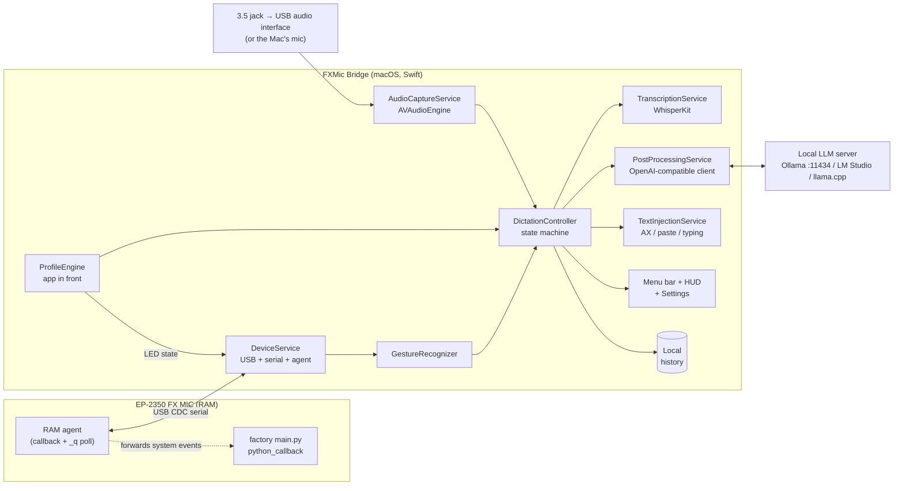

# TDD — FXMic Bridge: macOS app for local dictation with the EP-2350 FX MIC

> Version: v1
> Date: 2026-10-15
> Author: g.caletti@reply.it
> Status: Approved. Updated on 2026-10-15 with the results of the M0 spikes, see `logs/TEST_NOTES.md`.
> **Note of 2026-10-23:** Modes and Styles (orange and white, §3.2–§3.3 and the configuration schema) were replaced first by [One-Pager 001](onepager-001-interaction-modes-and-slots.md) (modes and slots) and then by [One-Pager 004](onepager-004-channels-and-commands.md) (channels, skills and commands, voice command). For the current gestures see [`docs/GESTURES.md`](../GESTURES.md); the rest of this document (transcription, RAM agent, protocol, text injection) still applies.

## 1. Context and goals

**Introduction**
FXMic Bridge is a macOS app that lives in the menu bar and turns the EP-2350 FX MIC into a dictation controller. You hold the handle, talk, and the text transcribed locally with Whisper is typed where the cursor is. Before it is typed, the text can go through a local LLM with a prompt chosen with the mic's buttons.

The project starts from the exploratory tests in `logs/TEST_NOTES.md`. Those tests showed that the mic's MicroPython console over USB lets you read buttons, handle and accelerometer in real time, and drive the LEDs, without writing anything to the device's flash or disk.

**Goals**
- **Push-to-talk:** the handle starts and stops recording, with a keyboard shortcut as a fallback when the mic is not connected.
- **Local transcription** with WhisperKit. Target: text typed within **1.5 s** of releasing the handle for a 10 s sentence in Raw mode (value to be measured in M1).
- **Optional post-processing** through a local OpenAI-compatible LLM endpoint. Target: within **3 s** with a 3–4 billion parameter model.
- **Text typed into the app in front**, at the cursor. It must work in Terminal/iTerm (Claude Code, Codex), browsers, Slack, Mail, Notes and VS Code.
- **Buttons mapped to prompts** through **per-app profiles**:
  - orange picks the Mode;
  - white picks the Style;
  - grey runs actions.

  The mapping changes automatically with the app in front, and the mic's LEDs show the state of the active profile.
- **Device always restorable:** the app never writes to the flash, the ROM or the FX MIC DISK. Every change lives in the mic's RAM and disappears when the app quits or the mic is switched off.

**Non-goals (v1)**
- Audio over the USB-C cable (streaming over serial): it will be a spike in M4.
- Custom firmware, changes to the mic's `config.json` or samples.
- Streaming transcription with partial text typed while you talk. In v1 the text is typed all at once on release, and the interface shows only the level meter.
- Windows or Linux support, and distribution on the Mac App Store.
- Cloud transcription or LLM services. The endpoint is configurable, but the default and supported value is localhost.

## 2. Overall architecture

**Component diagram**



**Main flow (dictation with post-processing)**
1. **Listening:** the user keeps the cursor in a text field. The agent on the mic sends `E 2 4` (handle pressed), and `GestureRecognizer` turns it into `pttDown`.
2. **Recording:** `DictationController` moves to `Recording`. `AudioCaptureService` records from the chosen input, converted to 16 kHz mono. The HUD shows the state, the active Mode and Style and the level meter.
3. **Release:** when the handle is released (`E 1 4`), `pttUp` arrives.
   - If the recording lasts less than 300 ms, or contains only silence, it is discarded.
   - Otherwise the audio goes to `TranscriptionService`, which returns the raw text.
4. **Post-processing:** if the active profile's Mode is not Raw, `PostProcessingService` builds the prompt (base + Mode + Style + context) and calls `/v1/chat/completions`.
5. **Typing:** `TextInjectionService` types the result into the app in front with the strategy set by the profile. The history saves the raw and the processed text.
6. **Errors:** if the LLM fails or times out, the raw text is typed and the HUD reports "LLM not available".

## 3. Detailed design

### 3.1 Device protocol (DeviceService)

**Detection**
- IOKit USB attach and detach notifications, filtered on VID `0x2367` and PID `0x0620`.
- The serial port is `/dev/cu.usbmodemEP*`. The protocol is CDC, so the configured baud rate is ignored.
- The port is opened with POSIX/termios directly, with no external dependencies.

**Handshake**
1. On opening, the mic prints `MICROPYTHON <v>; EP-2350 <fw>` followed by the `>>> ` prompt.
2. The app compares `<fw>` with a list of compatible versions, initially only `1.0.9`.
   - Version in the list: go ahead.
   - Version not in the list: "read-only" mode with a warning. Events are read without hiding the factory actions.
3. The app checks that `python_callback`, `ui`, `fx` and `spl` exist.

**Installing the agent**
The agent is loaded into RAM with MicroPython's paste mode (Ctrl-E … Ctrl-D), with the same technique as `tools/event_tap.py`, already verified:

```python
_pt = False            # passthrough: True = the mic behaves as from the factory
def _tap(m):
    t = m >> 16; v = m & 0xFFFF
    if t in (1, 2):
        print('\nE', t, v)               # leading '\n': the event may arrive while the REPL shows '>>> '
        if not _pt and v in (0, 1, 2):   # hides the buttons, the mic stays "clean"
            return
    elif t == 4:
        print('\nE', t, v)               # disk ejected: lets the config reload
    python_callback(m)                   # handle, tick, ADC, eject → factory logic
def _q(): print('Q', round(ui.handle(), 3), round(ui.shaker(), 3), ui.acc())
ui.callback(_tap); fx.load_preset(-1); print('AGENT_OK')
```

**Output line format** (one per line, separated by `\r\n`)

| Line | Meaning |
|---|---|
| `E <type> <value>` | Event. type 1/2 = active/inactive; value 0 = grey, 1 = white, 2 = orange, 4 = handle (inverted polarity: 2 = pressed). type 4 = disk ejected. |
| `Q <handle 0..1> <shaker> [ax, ay, az]` | Poll answer, at 10 Hz (verified up to 19 Hz). |
| `AGENT_OK` / `AGENT_OFF` | Agent installed or removed. |

**Tolerant parsing (M0-c result).** The callback output can end up on the same line as the prompt, for example `>>> E 1 1`. The parser must therefore look for `E <t> <v>` and `Q …` anywhere in the line, not only at the start. With this fix 40 events out of 40 were captured.

**Commands from the app**
They are text lines sent to the REPL and serialised in a queue, one at a time:
- `_q()` for polling;
- `ui.leds(<red>,<white>)` for the LEDs. **Verified in M0-b**: it draws two bars, and the value *n* lights *n+1* LEDs. With -1 the red ones are all off; the white ones always show at least one LED. Red shows the Mode (off = Raw), white the Style;
- `ui.led_control(0)` switches to manual control, where `ui.led_level(i, level)` works with i from 0 to 7 and `leds()` is ignored. `ui.led_control(1)` goes back to factory control. It is needed for animations such as blinking while recording. Which index matches which LED, and the brightness scale, are still to be defined: by eye, every value above 0 seems to light the LED at full brightness;
- `_pt=True` / `_pt=False` for passthrough mode.

**Restoring**
It happens when the app quits, when the user chooses "Release device" or when the disk state changes:

```python
ui.callback(python_callback); ui.led_control(1); ui.leds(fx_pos, sam_pos); fx.load_preset(fx_pos); print('AGENT_OFF')
```

**Reconnection (verified in M0-c).** If the cable is unplugged or the mic switched off, reading fails with `Errno 6 Device not configured`. The port comes back 10–20 s after switching on again, and the agent reinstalls in about 150 ms. Polling `/dev/cu.usbmodemEP*` every 0.5 s is enough for M1; IOKit notifications remain an improvement.

If the app quits abnormally, the agent stays active until the mic is switched off. On restart the app detects `_tap` in `globals()` and reinstalls it idempotently. The menu also offers "Restore device", which uses the same logic as `tools/restore.py`.

**Never used:** `test.bootloader`, `ui.shutdown`, `rp2.Flash`, `vfs.*`, writing to `/fat`.

### 3.2 Gesture recognition (GestureRecognizer)

It turns raw events into gestures with configurable thresholds.

| Input | Gesture | Default rule |
|---|---|---|
| Handle | `pttDown` / `pttUp` | Events `E 2 4` / `E 1 4`. Alternatively the analogue position with hysteresis: pressed above 0.15, released below 0.06. |
| Each button | `tap` | Press shorter than 450 ms, with no second tap within 300 ms. |
| Each button | `doubleTap` | Two taps within 300 ms. |
| Each button | `longPress` | Press of at least 600 ms. It fires during the press, without waiting for the release. |
| Grey during PTT | `chord(grey)` | Grey pressed while the handle is pressed: the current recording becomes an "edit the selection". |
| Shake | `shake` | `shaker` above 0.5 for at least 2 consecutive readings. From the tests: about 0 at rest, light shake 0.25–0.38, strong 0.6–0.9. |
| Handle | `handleDoubleClick` | Two presses shorter than 280 ms, with the second starting within 400 ms of the first release. The two presses are also recordings that are too short, so they are discarded without notices. *(Added on 2026-10-15)* |
| Shake | `shakeHold` | Strong shake (`shaker` above 0.5) held for at least 2 s. Dips below the threshold shorter than 400 ms do not stop the count. *(Added on 2026-10-15)* |

The up-to-date list of every gesture, action and the connection it needs (USB-C, jack or keyboard) is in [`docs/GESTURES.md`](../GESTURES.md).

**Default shortcuts** (in M1 they apply to every app; with the M2 profiles they become configurable per app):

| Gesture | Action | Keys sent |
|---|---|---|
| Double click on the handle | New line | ⇧↩ |
| Grey tap | Return | ↩ |
| Strong shake for 2 s | Clear all | ⌘A, then ⌫ |
| Short shake | Cancel the dictation in progress | — |

Every typed dictation ends with a space, unless it already ends with a space or a newline, so the next sentence does not stick to the previous one.

**Known limits:**
- "Clear all" with ⌘A acts on the whole active field or document. In a text editor it deletes the whole document, recoverable with ⌘Z. In terminals ⌘A selects the scrollback and not the prompt, so the prompt is not cleared. Claude Code in the terminal needs an app-specific action in M2, for example Ctrl+U.
- ⇧↩ makes a new line in Claude Code only in terminals configured for it (iTerm2, Ghostty, VS Code after `/terminal-setup`). Terminal.app uses ⌥↩.

While the handle is pressed, orange and white do not change Mode or Style, as the factory firmware does. This avoids accidental changes while talking.

### 3.3 Per-app profiles (ProfileEngine)

- **Choosing the profile:** `NSWorkspace.didActivateApplicationNotification` returns the bundle ID of the app in front.
  - The profile is the first one that contains that bundle ID in `apps`.
  - If none matches, `default` is used.
- **State per profile:** each profile remembers its Mode and its Style. When the app changes the LEDs update at once, and the HUD shows for 1.2 s a notice with the names of the profile, the Mode and the Style.
- **Orange:** cycles through `Raw` (orange LEDs off, -1) and up to 4 Modes (LEDs 0 to 3).
- **White:** cycles through up to 4 Styles (white LEDs 0 to 3). Style 0 is "Neutral", with an empty prompt. In Raw mode Styles are ignored.
- **Grey:** has configurable actions for `tap`, `doubleTap`, `longPress` and `chord`.

**Data model.** The file is `~/Library/Application Support/FXMicBridge/config.json` and has a versioned schema.

```json
{
  "schemaVersion": 1,
  "audio": { "inputDeviceUID": "AppleUSBAudioEngine:...", "preRollMs": 300, "minDurationMs": 300 },
  "speech": { "model": "openai_whisper-large-v3-turbo", "language": "auto", "vocabulary": ["Claude", "MCP", "repo"] },
  "llm": { "baseURL": "http://localhost:11434/v1", "model": "qwen3:4b", "timeoutMs": 8000, "temperature": 0.2,
           "baseSystemPrompt": "You are a dictation post-processor. Return only the final text, with no comments." },
  "injection": { "defaultStrategy": "paste", "restoreClipboardMs": 250 },
  "history": { "enabled": true, "retentionDays": 7, "saveAudio": false },
  "gestures": { "longPressMs": 600, "doubleTapMs": 300, "shakeThreshold": 0.5 },
  "profiles": [
    {
      "id": "default", "name": "General", "apps": [],
      "modes": [
        { "name": "Clean", "prompt": "Fix punctuation and transcription errors, keep the words." },
        { "name": "Email", "prompt": "Rewrite as a clear, polite email." },
        { "name": "Translate EN", "prompt": "Translate into natural English." },
        { "name": "List", "prompt": "Turn it into a short bullet list." }
      ],
      "styles": [
        { "name": "Neutral", "prompt": "" },
        { "name": "Concise", "prompt": "Be as short as possible." },
        { "name": "Formal", "prompt": "Formal register." },
        { "name": "Friendly", "prompt": "Informal, friendly tone." }
      ],
      "grey": { "tap": { "type": "key", "keys": "return" },
                "doubleTap": { "type": "undoLastInsertion" },
                "longPress": { "type": "reinsertLast", "variant": "raw" },
                "chord": { "type": "editSelection" } },
      "shake": { "type": "cancel" },
      "injection": null
    },
    {
      "id": "coding-agent", "name": "Coding agent",
      "apps": ["com.apple.Terminal", "com.googlecode.iterm2", "com.mitchellh.ghostty", "com.microsoft.VSCode"],
      "modes": [
        { "name": "Instruction", "prompt": "Rewrite as a clear, complete instruction for a coding agent. Keep file names, symbols and commands exact." },
        { "name": "Bug report", "prompt": "Structure it as: expected behaviour, observed behaviour, steps to reproduce." },
        { "name": "Commit msg", "prompt": "Write a conventional commit message." },
        { "name": "Question", "prompt": "Phrase a precise question about the code." }
      ],
      "styles": [ { "name": "Neutral", "prompt": "" }, { "name": "Concise", "prompt": "At most 2 sentences." },
                  { "name": "Detailed", "prompt": "Include acceptance criteria." }, { "name": "English", "prompt": "Write in English." } ],
      "grey": { "tap": { "type": "key", "keys": "return" },
                "doubleTap": { "type": "text", "text": "/clear\n" },
                "longPress": { "type": "key", "keys": "escape" },
                "chord": { "type": "editSelection" } },
      "shake": { "type": "cancel" },
      "injection": "paste"
    }
  ]
}
```

**Action types:**

| Type | What it does |
|---|---|
| `key` | Key combination, for example `return`, `cmd+z`, `escape`. |
| `text` | Literal text, with `\n` = Return. Useful for example to launch a `/skill`. |
| `prompt` | Applies a prompt to the selected text, without dictation. |
| `editSelection` | Applies the dictated instruction to the selected text. |
| `undoLastInsertion` | Undoes the last insertion. |
| `reinsertLast` | Retypes the last text, in the `raw` or `processed` version. |
| `cancel` | Cancels the dictation in progress. |
| `cycleProfile` | Moves to the next profile. |
| `none` | No action. |

### 3.4 Prompt composition (PostProcessingService)

```
system = llm.baseSystemPrompt
       + "\n\n## Mode: " + mode.prompt
       + (style.prompt ? "\n## Style: " + style.prompt : "")
       + "\n## Context: app={{app_name}}, language={{language}}, date={{date}}"
user   = "{{transcript}}"                                  // normal dictation
user   = "Text:\n{{selection}}\n\nInstruction:\n{{transcript}}"   // editSelection
```

- **Call:** `POST {baseURL}/chat/completions` with `stream: false` and `temperature` taken from the config.
- **Cleaning the answer:** the app strips extra whitespace and `<think>…</think>` blocks, for models that "reason".
- **Timeout or error:** the raw text is used and the error stays in the history.
- **Cold start:** after the first call Ollama keeps the model in memory for 5 minutes (`keep_alive`). The app can send a "warm-up" request when you switch to a Mode other than Raw.

### 3.5 Dictation state machine (DictationController)

```
Idle --pttDown--> Recording
Recording --pttUp (≥ minDuration)--> Transcribing
Recording --pttUp (< minDuration) | shake--> Idle (discarded)
Transcribing --text--> PostProcessing (mode ≠ Raw) | Injecting (Raw)
Transcribing --empty/silence--> Idle (HUD: "No speech")
PostProcessing --ok | error/timeout (use raw)--> Injecting
Transcribing | PostProcessing --shake--> Idle (cancelled)
Injecting --> Idle (save to history, remember the insertion for undo)
```

- **One dictation at a time** is processed. A `pttDown` while another one is in progress is ignored with a short error sound and a blink in the HUD.
- **Mode and Style are fixed at the start of recording:** they are the ones active at `pttDown`.
- **`editSelection`:** at `pttDown` with grey pressed, the app reads the current selection through AX (`kAXSelectedTextAttribute`). If AX does not work, it saves the clipboard, simulates `cmd+c`, reads the text and restores the clipboard. If there is no selection, the dictation goes ahead as normal.

### 3.6 Audio (AudioCaptureService)

- **Recording:** `AVAudioEngine` with a tap on the input chosen by CoreAudio UID, converted to 16 kHz Float32 mono, the format Whisper requires.
- **Pre-roll:** a ring buffer keeps the last 300 ms before `pttDown`, useful above all with the Mac's mic. With the FX-MIC the microphone turns on only while the handle is pressed, so the pre-roll contains silence.
- **Supported inputs:**
  1. FX-MIC through the jack into a USB audio interface with a line input. The output level reaches 2 Vrms, so it is set with the volume knob under the lid.
  2. Any system microphone, as a fallback: in this case the FX-MIC is only a controller.
- **Pre-roll deferred (decision of 2026-10-15, after the M1 test).** In M1 the audio engine starts at `pttDown`, so there is no pre-roll. Recording starts after about 130–150 ms, and the very first one after launch after 1.75 s. This is accepted while the source stays the Mac's mic: with the FX-MIC through the jack the microphone turns on only while the handle is pressed, and the pre-roll would not be needed. To be reassessed in M0-a, with the audio interface.
- **Silence detection:** if the average RMS level stays below -50 dBFS, the recording does not go to Whisper. It avoids the sentences Whisper makes up on silence.

### 3.7 Transcription (TranscriptionService)

- **Engine:** WhisperKit (Core ML, Apple Silicon), through a SwiftPM package.
- **Models:**
  - `large-v3-turbo` by default;
  - `small` as a light alternative.

  They are downloaded from the first-run setup, and the download can be managed from Settings.
- **Language:** `auto`, or fixed per profile.
- **Vocabulary:** `speech.vocabulary`, together with the profile's vocabulary, becomes Whisper's initial prompt, to recognise technical terms better.

### 3.8 Typing the text (TextInjectionService)

The strategies can be chosen per profile:

| Strategy | How it works | Pros | Cons |
|---|---|---|---|
| `paste` (default) | Saves the clipboard, fills it with the text (type `org.nspasteboard.TransientType`), simulates ⌘V, then restores the clipboard after 250 ms. | Works almost everywhere, terminals included, and is fast. | Some apps block pasting, and there is a brief risk of clipboard conflicts. |
| `ax` | `AXUIElementSetAttributeValue(focused, kAXSelectedText, text)` | Does not touch the clipboard. | Does not work in terminals or in most Electron apps. |
| `type` | `CGEvent` with `keyboardSetUnicodeString`, in blocks of 20 characters. | Works where pasting is blocked. | Slow for long texts and can interfere with autocompletion. |

**Rules common to all strategies:**
- **Secure fields:** if `IsSecureEventInputEnabled()` is on, for example in a password field, the app types nothing and reports it in the HUD.
- **Undo:** the last insertion is remembered, that is app, length and time. `undoLastInsertion` sends `cmd+z` only if the app in front is the same and less than 30 s have passed.

### 3.9 User interface

**Menu bar icon**
- **States:** ready, recording (red), transcribing/processing (animated), mic disconnected (grey, struck through), error.
- **Menu:**
  - current profile, Mode and Style, also changeable from the menu;
  - the last 5 texts, clickable to copy them;
  - "Release/Restore device", Settings, Quit.

**HUD**
- It is a semi-transparent pill at the bottom centre of the screen.
- **While recording** it shows:
  - the state;
  - the Profile, Mode and Style labels, for example `Coding agent · Instruction · Concise`;
  - a level meter;
  - a timer.
- **While processing** it shows an animation.
- **On Mode or Style changes** it appears for 1.2 s, because the LEDs only show an index and the names are needed.

**Update of 2026-10-16 (app 0.2.x).**
- **The HUD becomes a black "island" at the top of the active screen**, that is the one under the pointer:
  - on screens with a notch it comes out of the notch, with a status symbol on the left and the timer on the right of the notch, and title, detail and level below;
  - without a notch it is a black pill centred just below the menu bar.
- **The menu bar icon is chosen from a submenu** and saved in `config.json`:
  - it can be set with `ui.menuBarIcon`, which is `auto`, `logo`, one of the SF Symbols presets (`mic`, `micCircle`, `waveform`, `dot`, `sparkles`) or `file`;
  - with `file` you set `ui.menuBarIconFile`, an SVG, PDF or PNG that is copied into `icons/` and drawn monochrome;
  - during recording, processing and errors the status symbols remain.

**Settings** (a SwiftUI window with tabs)
1. **Device:** status, firmware, LED test, handle and shake thresholds with live meters, passthrough switch.
2. **Audio:** input selection, level meter, recording test.
3. **Transcription:** model and download, language, vocabulary.
4. **LLM:** endpoint URL, model (with the list from `/v1/models`), "Try prompt" button, timeout.
5. **Profiles:** visual editor. You pick apps from the list of installed ones, write Modes and Styles with a preview that applies the prompt to a sample sentence, map the grey actions and import or export profiles as JSON.
6. **History:** raw and processed texts, with copy, retype and delete. Configurable retention, which can also be turned off.

**First-run setup:** asks for the Microphone and Accessibility permissions, offers to download the Whisper model, checks the mic and tests the LLM endpoint.

**Sounds:** short clicks at the start and end of recording, which can be turned off.

## 4. Non-functional requirements and infrastructure

**Performance**
- **Latency from release to typed text, Raw mode:** target under 1.5 s with 10 s of speech on an M5 with 16 GB.
- **Latency with LLM:** target under 3 s with a 3–4 billion parameter model already in memory.
- **Event latency from the mic:** under 50 ms (about 4 ms observed between events).
- **Memory:**
  - about 1.5 GB with the turbo model loaded;
  - about 0.5 GB with `small`.

  The model is unloaded from memory after 10 minutes of inactivity (configurable).
- **CPU at rest:** under 1%. Serial polling at 10 Hz is light, and when the mic is disconnected polling stops.

**Security and privacy**
- **Local processing:** everything happens on the Mac. The network is used only for the configured LLM endpoint. If the host is not `localhost`, `127.0.0.1` or `::1`, the app shows an explicit warning.
- **Stored data:** audio is never saved to disk, except with the `saveAudio` option (off by default). The history is in a local JSONL file with `0600` permissions and a default retention of 7 days.
- **Required permissions:** Microphone and Accessibility (to paste, type and read the selection).
- **Signing and distribution:** the app is outside the sandbox, because AX and direct serial access are needed. It is signed with Developer ID and notarised, or ad-hoc signed for personal use.
- **Device:** the app never writes to the mic's flash and runs only REPL commands from an allow list written in the code.

**Observability**
- **Logs:** `os.Logger` with subsystem `com.fxmicbridge` and categories `device`, `audio`, `stt`, `llm`, `inject`. Text content does not appear in the logs, except in debug mode.
- **Local metrics** in the Diagnostics tab: latency per phase (recording, transcription, LLM, typing), LLM errors, mic reconnections.
- **Support:** the "Export diagnostics" button creates a zip with logs, configuration without prompts and the firmware version.

## 5. Alternatives considered

- **Python with rumps, pyserial and mlx-whisper.** Rejected as a product, because distribution, TCC permissions and launch at login are fragile. It stays useful for spikes, like the scripts already in `tools/`.
- **Tauri (Rust with a web interface).** Rejected because the macOS APIs needed (AX, CGEvent, pasteboard, CoreAudio, IOKit) would need native code anyway, and the only advantage would be a cross-platform interface, which is not a goal.
- **whisper.cpp instead of WhisperKit.** It stays a valid fallback behind the `TranscriptionEngine` interface. WhisperKit is preferred for the Swift integration and ANE acceleration.
- **LLM built in with MLX Swift.** Deferred until after v1: an OpenAI-compatible endpoint lets you change runtime and model without rebuilding the app.
- **Recognising buttons from the audio (samples with codes, jack only).** Rejected for v1: the USB serial line gives more precise, two-way (LEDs) events without using up the sample slots. The scheme stays documented in the initial analysis. Taken up again as an alternative "jack-only" transport in [One-Pager 002](onepager-002-jack-only-transport.md) and [ADR-002](../adr/adr-002-jack-only-acoustic-control-channel.md) (proposal rev. 2: FXMic firmware in `/rom/json.py`, [ADR-003](../adr/adr-003-persistent-fxmic-firmware-via-romfs-json-hook.md), tests T1–T9).
- **Using the mic's `config.json` or samples for gestures.** Rejected: it needs writing to the mic's disk, while the constraint is to leave no permanent changes.

## 6. Risks and open points

**Technology**
- **Jack input not verified.** Level, noise and the handle gate on the analogue output still have to be tried with an audio interface. Spike M0-a.
- ~~Behaviour of `ui.leds(fx, sam)`~~ **Solved in M0-b** (bars). The `led_level` index map and the brightness scale remain open.
- **`fx.load_preset`** works from -1 to 3 and restoring with `fx_pos` is verified, checking the loaded chain with `fx.timing()`. It has not yet been tried with the handle pressed: the agent calls it only at install time.
- **Volume knob** not visible from software. ADC channel 3 is an unconfirmed candidate.
- **Toolchain:** the Mac has only the Command Line Tools. With SwiftPM you can build an executable and assemble the `.app` bundle with a script, but full Xcode is more convenient for signing and notarising. TBD, to be confirmed with the user.

**Dependencies**
- WhisperKit (argmaxinc, MIT).
- A local LLM server, such as Ollama, already installed.
- No dependency on the fx-usb code, which has no licence.

**Points of failure**
- **Firmware other than 1.0.9:** the names `python_callback` or `fx_pos` might change. The app switches to read-only mode with a warning.
- **Serial port busy** with another program (fx-usb, `screen`, the scripts in `tools/`). The app shows the "Busy" status with the list of processes obtained from `lsof`.
- **Battery-powered mic:** it goes into power saving after 5 minutes and switches off after 20. The app detects the disconnection and reconnects when it comes back. With USB power the mic stays on.
- **LLM server not started:** the raw text is typed and the HUD suggests starting `ollama serve`.
- **Sentences Whisper makes up on silence:** mitigated by silence detection, the minimum duration and suppressing "no speech" tokens.

## 7. Migration strategy

The project starts from scratch, so there is no system to migrate. The release plan is in milestones:
- **M0 — Spikes (results of 2026-10-15):**
  - a) jack with an audio interface: **not run**, the audio interface is not available yet;
  - b) LED and `load_preset` APIs: **done**, with two open points (index map and brightness);
  - c) agent stability: **done**. More than 15 minutes without lost readings, reconnection after unplugging and switching off, 40 events out of 40 after the parser fix. The 2-hour test is deferred to real use in M1.
- **M1:** DeviceService, GestureRecognizer, Raw dictation with WhisperKit, typing with `paste`, menu bar icon. **Audio source in M1: the Mac's default microphone**, because the audio interface is missing. The FX-MIC is only a controller (handle = push-to-talk). `AudioCaptureService` stays tied to the system default input until there is a selector.
- **M2:** PostProcessingService, ProfileEngine with LEDs, Modes, Styles and grey actions, HUD. **Implemented on 2026-10-15 (app 0.2.0)**, with these differences from §3.3:
  - the schema assigns actions to every button, with `orange`, `white` and `grey`, each with `tap`, `doubleTap` and `longPress`; plus `chord`, `handle.doubleClick` and `shake.short`/`shake.hold`;
  - the `key` action type was added with a list of combinations, and `text` with a trailing `\n` to send;
  - `/clear\n` is no longer assigned to the grey double tap, to avoid clearing a conversation by mistake: now the double tap undoes the last insertion;
  - the Claude desktop app stays in the General profile, because it is a text field where ⌘A works;
  - the up-to-date list of gestures is in `docs/GESTURES.md`.
- **M3:** complete Settings, profile editor, history, first-run setup, signing. **Implemented on 2026-10-16:**
  - **Settings** (menu › Settings…, ⌘,): General, Device, Audio, Transcription, LLM, Profiles and History tabs. Changes are applied with "Save", which also creates `config.json.bak`.
  - **Profile editor:**
    - apps picked from /Applications;
    - up to 4 Modes and 4 Styles, with an LLM preview;
    - one action for each of the 13 gestures;
    - JSON import and export and restoring the defaults.
  - **Audio input:** selectable among the CoreAudio devices (`audio.inputDeviceUID`), ready for M0-a.
  - **History:** `history.jsonl` with 0600 permissions and configurable retention (`history.retentionDays`, 7 days by default), viewable and deletable from the History tab.
  - **First-run setup** in 5 steps with live status: Microphone, Accessibility, Whisper, FX-MIC, LLM. It reopens from menu › Guided setup….
  - **Stable signing:** `app/scripts/create-signing-identity.sh` creates a self-signed "FXMic Bridge Dev" identity (to be run once by the user); `bundle.sh` uses it automatically, so the Accessibility permission survives rebuilds. Developer ID signing and notarisation stay out of scope, because the app is for personal use.
- **M4:** spike on audio over USB-C with a DMA reader ported to firmware 1.0.9. If the result is positive, a new `AudioSource` is born in v2.

## 8. Rollback strategy

- **Device:** "Release device" or quitting the app restores `python_callback`, the LEDs and the preset. Switching the mic off and on clears the RAM anyway. To verify, you can use `tools/restore.py` (dry-run), which also checks that the FX MIC DISK is identical to the backup.
- **App:** just quit it and delete `FXMic Bridge.app` and `~/Library/Application Support/FXMicBridge/`. It installs no drivers, kernel extensions or virtual audio devices.
- **Configuration:** before every save, `config.json` is copied to `config.json.bak`, and it can be restored from Settings.

## Appendix A — UX proposals to evaluate

1. **Profile shown by the LEDs.** On an app change, a short blink of all the white LEDs signals that the profile has changed, besides showing Mode and Style.
2. **Grey held as a "momentary modifier".** As an alternative to `chord = editSelection`, grey pressed during PTT applies an alternative Mode for one dictation only, for example "Translate EN".
3. **Tilt gestures** (the accelerometer detects them well). Mic tilted left or right when the handle is released: types without the LLM, or also sends Return. Deferred until after v1 to avoid accidental triggers.
4. **Preview with confirmation** in the more delicate profiles (Email, Slack). The processed text appears in the HUD and is confirmed with a grey tap, or discarded by shaking the mic.
5. **Whisper mode.** With the handle pressed halfway (between 0.15 and 0.5) it records without post-processing, even with a Mode active: a quick way to dictate fast.
6. **Control voice commands.** If the transcription is exactly "new line", "send" or "cancel", it becomes the matching action instead of being typed.

---
**Related ADR:** `docs/adr/adr-001-device-control-via-ram-repl-agent.md`. Decision: control the mic with an agent installed in RAM only through the serial REPL, with no firmware or files on the device.
